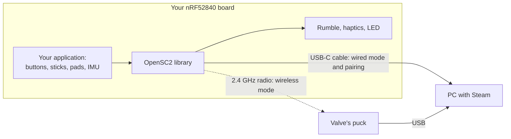
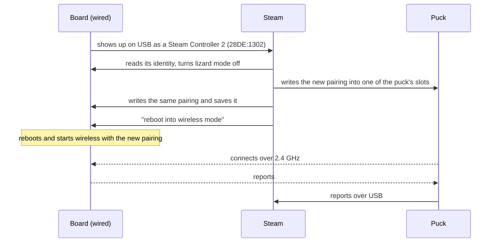
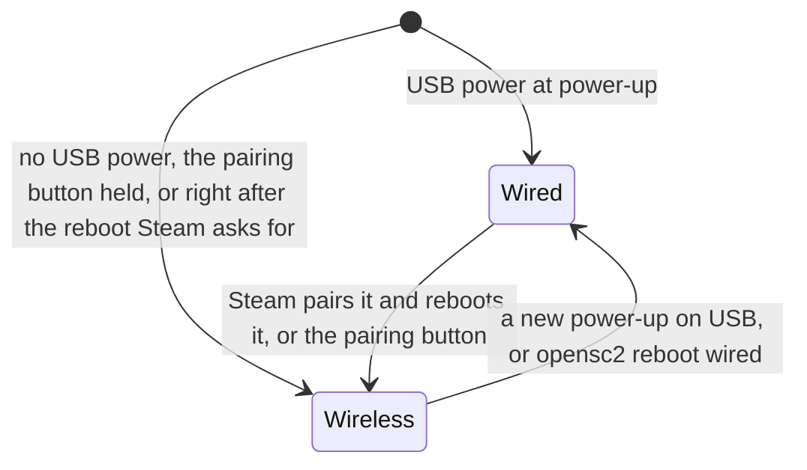

# OpenSC2-Controller

Make an nRF52840 board act as a Steam Controller 2.

[](https://github.com/ded811/OpenSC2-Controller/actions/workflows/ci.yml)


> [!NOTE]
> Unofficial: not affiliated with or endorsed by Valve. Steam and Steam Controller are trademarks of
> Valve Corporation. So that Steam recognises it, the firmware uses Valve's USB IDs (`28DE:1302`)
> and the real controller's USB strings, for personal interoperability and research use. It
> contains no Valve code or binaries. See [NOTICE.md](NOTICE.md).

Original code, written from the protocol documentation its authors published and from black-box
tests; no Valve code or binaries ([how it was made](#how-it-was-made)).

## What it is

OpenSC2 (Open Steam Controller 2) makes an nRF52840 board act as a Steam Controller 2. Steam pairs
it with Valve's puck over a USB-C cable, like a real controller, and it then connects through the
puck. It is a library (a Zephyr module for nRF Connect SDK v3.4.0), a ready-to-build firmware for
the SuperMini nRF52840, a template for your own project, six samples and an automated hardware
test suite.

- **The library** (`lib/opensc2`, `include/opensc2`) does the protocol: the puck's 2.4 GHz link,
  the wired USB device, pairing over the cable and the vendor commands Steam sends. Your code hands
  it the inputs (buttons, sticks, triggers, trackpads, IMU, battery) and gets the outputs (rumble,
  haptics, LED colour, settings) as callbacks. It has no pins of its own.
- **The firmware** (`app/`, "the blank canvas") is a complete Steam Controller 2 for the SuperMini
  nRF52840, a Pro Micro-sized nRF52840 board with the nice!nano pinout and the Adafruit nRF52 UF2
  bootloader. Every input is set up in one devicetree file: the SuperMini's pins carry the
  buttons, the digital triggers, one stick and the pairing button, and the other inputs are listed
  there, ready for a board with more pins. Wire what you have.
- **The template and the samples** (`template/`, `samples/`): a small project to copy as the start
  of your own, and six samples that each show one part.

Who it is for: makers who want to build a controller that Steam treats as a Steam Controller 2,
and firmware developers who want that protocol in their own nRF52840 project.

Valve's puck is the small USB receiver and charging dock that comes with the Steam Controller 2.
Steam talks to wireless controllers through it.



## What works

Tested with development builds of `app/` for 0.2.0 (the test suite's full run: 2026-10-19), on a
SuperMini nRF52840 with nothing wired to it, with Valve's puck on its October 2026 firmware and
Steam on a Windows PC. The release image is checked again before it is tagged
([docs/releasing.md](docs/releasing.md#b-release-v020-while-the-repository-is-private)).

| What | Status |
| --- | --- |
| It enumerates over USB exactly like a real Steam Controller 2 (`28DE:1302`). | Works on hardware |
| Steam pairs it with Valve's puck over the USB-C cable, like a real controller. | Works on hardware |
| It then reboots into wireless mode and connects through the puck. | Works on hardware |
| Steam's "needs an update" prompt goes away when the board reports a build time at least as new as Steam's current controller firmware. | Works on hardware |
| The automated hardware test suite passed 169 of 169 tests with every opt-in on: inputs injected and checked wired and through the puck, battery, rumble and haptics, LEDs, settings, all vendor commands Steam sends, lizard mode with nothing reaching the PC, reboots, mode switches, reconnects, and a run with Steam open. | Works on hardware |
| Real buttons, sticks, trackpads, IMU, rumble motor, RGB LED and battery hardware: the drivers in `app/` and the samples have never run on such parts. | Built; not tried with real parts |
| Pairing over the air (the puck's pairing window). | Built; untested with Steam |
| The charger test aid (a separate test build) on a real charger. | Built; not tried with real parts |
| The samples and the template: they build; none has run on hardware. | Built; not run on hardware |
| Other boards. | Not tested |
| Linux and macOS as the PC: the PC side was tested with Steam on Windows. | Not tested |
| Bluetooth. The dock (pogo pads). | Not implemented |
| Lizard mode's smoothing, glide and haptic ticks. PCM haptics playback in the samples. | Not implemented |

Details of the test run: [docs/testing.md](docs/testing.md#results-so-far).

## What you need

- **A SuperMini nRF52840.** It has three analog-capable pins (P0.02, P0.29, P0.31), and the
  default firmware uses P0.31 for the pairing button: one analog stick. For two sticks and analog
  triggers, use a board with six or more analog pins (for example the Seeed XIAO nRF52840, see
  [docs/porting.md](docs/porting.md); untested) or an external ADC.
- **Valve's puck** (tested with its October 2026 firmware).
- **A Windows PC with Steam**, and a **USB-C data cable** (not a charge-only cable).
- **To build:** git (or GitHub's **Code**, **Download ZIP**) and **nRF Connect SDK v3.4.0**.
  **Only to flash:** a `.uf2` from a release.

Nothing needs to be wired to try it.

## Quick start

**Only flashing?** If a [release](https://github.com/ded811/OpenSC2-Controller/releases) has a
`.uf2` attached, download it, check its SHA-256 against `SHA256SUMS.txt`
([how](docs/getting-started.md#get-the-code)) and go on with step 4.

1. **Get the code** (or download it with GitHub's **Code**, **Download ZIP** and unpack it):

   ```powershell
   git clone https://github.com/ded811/OpenSC2-Controller
   cd OpenSC2-Controller
   ```

2. **Install the SDK.** Install nRF Connect SDK v3.4.0 with nRF Connect for VS Code (Install SDK,
   then v3.4.0), or on the command line with
   [nRF Util](https://www.nordicsemi.com/Products/Development-tools/nRF-Util) (`nrfutil`, from
   Nordic's downloads): `nrfutil install sdk-manager`, then `nrfutil sdk-manager install v3.4.0`.
   The default folder is `C:\ncs` on Windows, `~/ncs` on Linux and `/opt/nordic/ncs` on macOS,
   with the SDK in its `v3.4.0` subfolder. `build.ps1` looks in `C:\ncs`; pass
   `-NcsRoot <folder>` for another one.
3. **Build** (Windows, PowerShell, in the repository folder):

   ```powershell
   powershell -NoProfile -ExecutionPolicy Bypass -File build.ps1 -Project app -OutDir C:\b\osc2
   ```

   This gives `C:\b\osc2\app\zephyr\zephyr.uf2`. `C:\b\osc2` is any short folder: Windows'
   260-character path limit breaks deep build folders.
4. **Flash.** Short RST to GND twice quickly: a USB drive appears. Copy `zephyr.uf2` onto it; the
   board restarts with the new firmware.
5. **Add it in Steam:**
   1. Plug the puck into the PC and start Steam. Switch a real Steam Controller 2 off and keep it
      unplugged while you add the board.
   2. In Steam, start adding a controller. Steam asks you to connect it with a USB-C cable.
   3. Plug the board in with a USB-C data cable (not a charge-only cable). It comes up wired: the
      LED is dark for half a second, then on with a short dark blink every 2 seconds.
   4. Steam pairs the board with the puck over the cable and reboots it into wireless mode: the LED
      goes dark, blinks slowly while the board looks for the puck, then stays on. The board is now
      connected through the puck.
   5. From then on the board connects through the puck by itself whenever it starts wireless.
      Plugged into a PC again it comes up wired; hold the pairing button (on a bare board: P0.31
      against GND) while plugging in to keep it wireless.

   If Steam later forgets the controller, add it again the same way.

On Linux or macOS, [docs/getting-started.md](docs/getting-started.md#build) has the build commands.
For everyday use you can set `CONFIG_OPENSC2_TEST_HOOKS=n` in `app/prj.conf` before building
([the hardware test hooks](app/README.md#the-hardware-test-hooks)).

## Wire it up

Buttons go between their pin and GND; the internal pull-ups hold them released. A thumbstick
module's two potentiometers go between VCC and GND, with the wipers on P0.02 (X) and P0.29 (Y).
Anything you leave out reads neutral. The silkscreen labels are short: "006" is P0.06, "111" is
P1.11. The pins: [app/README.md](app/README.md#pins).

## Use it in your own project

Start from [`template/`](template): a small SuperMini project with buttons, the pairing button,
wired mode and the shell, made to be copied out of this repository. Your project finds the library
in one of three ways, each explained in [docs/integration.md](docs/integration.md):
[a plain folder](docs/integration.md#way-1-a-plain-folder) (point `ZEPHYR_EXTRA_MODULES` at your
clone), [a git submodule](docs/integration.md#way-2-a-git-submodule) (the template finds
`modules/opensc2` by itself), or [a west workspace](docs/integration.md#way-3-a-west-workspace).

```c
#include <zephyr/kernel.h>
#include <opensc2/opensc2.h>

static void on_rumble(const struct opensc2_rumble *r, void *user_data)
{
    my_motor_set(MAX(r->left_speed, r->right_speed));   /* your hardware */
}

static const struct opensc2_callbacks callbacks = { .rumble = on_rumble };
static const struct opensc2_config config = { .callbacks = &callbacks, .start = true };

int main(void)
{
    int err = opensc2_init(&config);

    if (err) {
        printk("opensc2_init failed: %d\n", err);   /* the console still starts */
    }
    opensc2_set_buttons(OPENSC2_BTN_A, OPENSC2_BTN_A);      /* A pressed */
    opensc2_set_stick(OPENSC2_LEFT, 0, OPENSC2_AXIS_MAX);   /* left stick fully up */
    return 0;
}
```

Every function, field and option: [docs/api.md](docs/api.md).

## Examples

| Project | What it shows | Status |
| --- | --- | --- |
| [app/](app/README.md) | the full firmware: every input set up in one overlay, both modes, LED, shell, test hooks | tested with nothing wired ([What works](#what-works)) |
| [template/](template) | the start of your own project: buttons, pairing button, wired mode, shell | builds; not run on hardware |
| [samples/minimal](samples/minimal) | the smallest application: init, one button, the pairing button | builds; not run on hardware |
| [samples/buttons_sticks](samples/buttons_sticks) | buttons, a stick and a trigger from devicetree (gpio-keys and ADC) | builds; not run on hardware |
| [samples/touchpad](samples/touchpad) | a Cirque Pinnacle trackpad module as the right trackpad | builds; not run on hardware |
| [samples/imu](samples/imu) | an MPU-6050 through Zephyr's sensor API, with the fusion helper | builds; not run on hardware |
| [samples/rumble](samples/rumble) | rumble and haptics on a PWM-driven vibration motor | builds; not run on hardware |
| [samples/rgb_led](samples/rgb_led) | an RGB LED that follows Steam's LED colour | builds; not run on hardware |

[samples/README.md](samples/README.md) has the parts, pins and what each sample teaches.

## How it works

Steam pairs a controller with the puck over the cable:



Each boot is wired or wireless, decided once at power-up, as on the real controller:



Lizard mode: until Steam takes over, a Steam Controller 2 acts as a plain mouse and keyboard (the
right trackpad moves the pointer, A is Enter, B is Escape, the D-pad gives the arrow keys). Steam
switches it off while it runs; about 10 seconds after Steam stops, it comes back. OpenSC2 does the
same.

The protocol in brief, with links to the full documentation: [docs/protocol.md](docs/protocol.md).
The boot rule and every way to switch: [docs/api.md](docs/api.md#modes).

## Testing

- **Host tests**, no hardware: 52 host tests (2,209 checks); 79 (4,658 checks) with the hardware
  test hooks built in, and the two builds answer 2,000 unarmed commands byte for byte alike; the
  runner's 207 self-tests; its dry run against the library's own code in a firmware emulator; 9
  self-tests of `tools/match_steam_version.py`. Run
  `powershell -NoProfile -ExecutionPolicy Bypass -File tests\host\run.ps1` on Windows (with a gcc
  on PATH, for example MSYS2's ucrt64 gcc) or `sh tests/host/run.sh` on Linux and macOS. They are
  tested with gcc; clang (also what `gcc` runs on macOS) is not tested.
- **The hardware test suite** (`tools/hwtest`) checks a board with nothing wired, from the PC: with
  the 0.2 development build of `app/` (2026-10-19), 169 of 169 tests passed (0 failed, 0 errors,
  0 warnings) with every opt-in on: `--through-puck --flash --lizard --with-steam --steam-control`.
  Only the optional soak test (`--soak S`), which needs a duration, was not run.

How to run both, and what the suite checks: [docs/testing.md](docs/testing.md).

## Troubleshooting

| Symptom | Where to look |
| --- | --- |
| Steam says the controller needs an update | [the update prompt](docs/troubleshooting.md#steam-asks-to-update-the-controller) |
| Steam does not see the board | [Steam does not see the board](docs/troubleshooting.md#steam-does-not-see-the-board) |
| The LED blinks slowly and never stays on | [not connected to the puck](docs/troubleshooting.md#the-led-blinks-slowly-and-never-stays-on) |
| The board types or moves the pointer when Steam is closed | [lizard mode](docs/troubleshooting.md#the-board-types-or-moves-the-pointer-when-steam-is-closed) |
| The hardware test suite refuses the board | [the suite's rules](docs/troubleshooting.md#the-hardware-test-suite-refuses-my-board) |

More answers in [docs/troubleshooting.md](docs/troubleshooting.md).

## Documentation

The [documentation map](docs/README.md) lists every page and has a glossary. The main pages:

- [Getting started](docs/getting-started.md): install, build, flash and add the board, on each OS.
- [Use OpenSC2 in your own project](docs/integration.md) and the [API reference](docs/api.md).
- [The protocol, in brief](docs/protocol.md), with the gaps the library had to fill.
- [Porting to other boards](docs/porting.md), [testing](docs/testing.md) and
  [troubleshooting](docs/troubleshooting.md).

## How it was made

OpenSC2 is original code. It was written from the protocol documentation the same authors published
in [steam-controller-2-reverse-engineered](https://github.com/ded811/steam-controller-2-reverse-engineered)
(which they wrote by studying the controller's firmware), plus black-box tests and USB captures of
Steam with a real controller. It is not a clean-room implementation. It contains no Valve code or
binaries.

In more detail, it was written from:

- the research pages on the controller's radio link to the puck, its USB device, the wired session
  and pairing over the cable, the reports, the vendor commands, the controller settings and lizard
  mode ([docs/protocol.md](docs/protocol.md) links each one);
- a few facts from the same authors' study of the controller's firmware that are not yet on the
  published pages: the ranges of seven settings, details of the report descriptor (the sizes of
  its mouse and keyboard collections, the form of its items, the order of its reports), and lizard
  mode's key-slot rule, its scales and when its mouse reports go out
  ([docs/protocol.md](docs/protocol.md#where-this-library-had-to-fill-gaps) lists each);
- the documentation and black-box tests of [Counterpuck](https://github.com/ded811/Counterpuck),
  the same authors' open firmware for the puck side of the link;
- the public names, and a few enum values and layouts, declared in SDL's open-source Steam
  Controller 2 driver (the names of reports, buttons and settings, `EChargeState`, the gyro-mode
  bits, the rumble report's layout), with no SDL code;
- this project's own black-box tests with Steam and Valve's puck ([docs/testing.md](docs/testing.md)).

None of its code comes from Valve's firmware or from a reconstruction of it. Where the
documentation leaves a gap, the code does what should work, and
[docs/protocol.md](docs/protocol.md#where-this-library-had-to-fill-gaps) lists each gap.

## Licence and trademarks

The code and documentation here are MIT licensed ([LICENSE](LICENSE)). A built image also contains
code from Zephyr, the nRF Connect SDK, Nordic's MPSL and CryptoCell libraries, nrfx, picolibc and
libgcc, under their own licences; [THIRD_PARTY.md](THIRD_PARTY.md) lists them and where their texts
are. Steam and Steam Controller are trademarks of Valve Corporation: [NOTICE.md](NOTICE.md).

## Contributing

Bug reports, hardware reports and pull requests are welcome. [CONTRIBUTING.md](CONTRIBUTING.md)
covers provenance, privacy, building and testing; the issue forms ask for what helps (a bug, a
hardware report, a new board). [CHANGELOG.md](CHANGELOG.md) lists the changes, and
[SECURITY.md](SECURITY.md) says how to report a security problem.

## Repository layout

```text
zephyr/module.yml, CMakeLists.txt, Kconfig   the Zephyr module
include/opensc2/        public headers: opensc2.h (the API), types.h, codec.h (wire formats and USB
                        descriptors), settings.h, fusion.h
include/dt-bindings/opensc2/inputs.h   button bit numbers, for C and devicetree
lib/opensc2/            the library: radio.c (the puck link), usb.c and usb_desc.c (wired mode),
                        commands.c (vendor commands), report.c (reports on every link), lizard.c
                        (lizard mode), mode.c (wired or wireless), usblog.c (the session log),
                        storage.c, shell.c, test_*.c (the hardware test hooks)
app/                    the blank-canvas firmware for the SuperMini; app/build.ps1 builds it
template/               a small project to copy as the start of your own
samples/                minimal, buttons_sticks, touchpad, imu, rumble, rgb_led
tests/host/             host tests (run.ps1, run.sh) and the firmware emulator (fwemu.c)
tests/codec/            the pure test cases as a ztest suite (optional; native_sim on Linux)
tests/vectors/hwtest/   vectors that the host tests and the hardware test suite both check
tools/hwtest/           the hardware test suite (Python; hardware runs on Windows)
tools/match_steam_version.py   gives a board the build time of Steam's current controller firmware
tools/check_links.py    checks the links and anchors in the documentation
tools/collect_licenses.py   writes THIRD_PARTY_LICENSES.txt for a release
docs/                   the documentation; docs/README.md is the map
build.ps1, ncs_env.ps1  Windows build helpers
```
