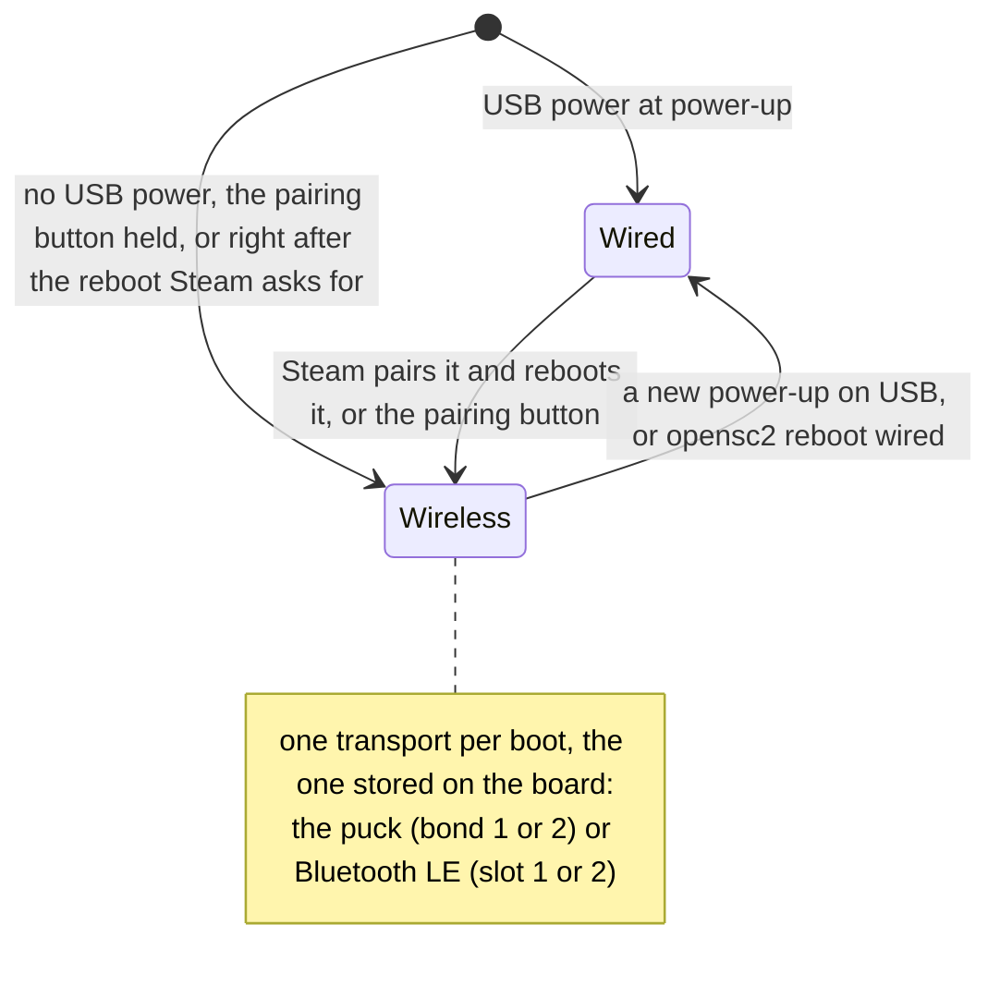

# OpenSC2 firmware for the SuperMini nRF52840 (the blank canvas)

The finished firmware of this repository, for makers: it makes the SuperMini nRF52840, a Pro
Micro-sized nRF52840 board with the nice!nano pinout and the Adafruit nRF52 UF2 bootloader, act as
a Steam Controller 2, wired on its USB-C cable or wireless through Valve's puck. Wire buttons and a
stick to the pins below, or nothing at all to try it.

> [!NOTE]
> Unofficial: not affiliated with or endorsed by Valve. Steam and Steam Controller are trademarks
> of Valve Corporation. So that Steam recognises it, the firmware uses Valve's USB IDs
> (`28DE:1302`) and the real controller's USB strings, for personal interoperability and research
> use. It contains no Valve code or binaries. See [NOTICE.md](../NOTICE.md).

The hardware results come from this firmware ([What works](../README.md#what-works)): from its
v0.2.0 release image (2026-11-01), on a SuperMini nRF52840 with nothing wired to it, with Valve's
puck on its October 2026 firmware and Steam on a Windows PC: wired, through the puck and over
Bluetooth LE to Windows, and the hardware test suite with inputs injected through the test hooks.
The firmware's code for real buttons, sticks, trackpads, IMU, rumble motor, haptic actuators, RGB
LED and battery hardware has not run on such parts yet. Valve's puck is the small USB receiver and charging dock
that comes with the Steam Controller 2; Steam talks to wireless controllers through it.

Every input is set up in one file,
[boards/promicro_nrf52840_nrf52840_uf2.overlay](boards/promicro_nrf52840_nrf52840_uf2.overlay):
change a pin there, or delete an input you do not wire.

| Section | For |
| --- | --- |
| [Build and flash](#build-and-flash), [Add it in Steam](#add-it-in-steam) | getting it running |
| [Pins](#pins) | wiring buttons and a stick |
| [Wired and wireless modes](#wired-and-wireless-modes), [LED](#led) | what the board does and shows |
| [The serial console](#the-serial-console-wireless-mode), [Identity](#identity), [Steam's firmware update](#steams-firmware-update) | looking inside and changing what Steam sees |
| [Optional parts](#optional-parts), [Build options](#build-options), [A battery build](#a-battery-build) | more hardware, other settings |
| [The haptics synthesiser](#the-haptics-synthesiser), [Bluetooth LE](#bluetooth-le) | in the default build |
| [The hardware test hooks](#the-hardware-test-hooks), [Test build: the charger fallback](#test-build-the-charger-fallback), [The dock build](#the-dock-build-untested), [Test build: everything without parts](#test-build-everything-without-parts) | testing (the last two: built, not yet tested on hardware) |

## Build and flash

You need nRF Connect SDK v3.4.0
([Install the nRF Connect SDK](../docs/getting-started.md#install-the-nrf-connect-sdk)).
`build.ps1` looks for it in `C:\ncs`; pass `-NcsRoot <folder>` for another one.

**Windows**, in PowerShell in the repository folder:

```powershell
powershell -NoProfile -ExecutionPolicy Bypass -File build.ps1 -Project app -OutDir C:\b\osc2
```

The image is `C:\b\osc2\app\zephyr\zephyr.uf2`. `C:\b\osc2` is any short folder: Windows'
260-character path limit breaks deep build folders. Without `-OutDir` the image is
`build\app\app\zephyr\zephyr.uf2` in the repository. In this folder,
`powershell -NoProfile -ExecutionPolicy Bypass -File .\build.ps1 -OutDir C:\b\osc2` does the same;
it also takes `-Pristine`, `-Board`, `-NcsRoot`, and `-TestCharger` for the
[test build](#test-build-the-charger-fallback).

**Linux and macOS**, from the repository folder. The first command opens a shell with the SDK's
tools; type the other two in that shell:

```sh
nrfutil sdk-manager toolchain launch --ncs-version v3.4.0 --shell
export ZEPHYR_BASE=~/ncs/v3.4.0/zephyr      # macOS: /opt/nordic/ncs/v3.4.0/zephyr
west build -b promicro_nrf52840/nrf52840/uf2 -d build/app app
```

The image is `build/app/app/zephyr/zephyr.uf2`. Building on Linux and macOS follows the nRF Connect
SDK's own instructions; it has not been tried for this project yet.

If a [release](https://github.com/ded811/OpenSC2-Controller/releases) has a `.uf2` attached, you can
download it instead of building, and check its SHA-256 against `SHA256SUMS.txt`.

**Flash**: short RST to GND twice quickly: a USB drive appears. Copy `zephyr.uf2` onto it; the board
restarts with the new firmware. The image lands at the UF2 bootloader's application address,
`0x26000`, because the Partition Manager is off (`sysbuild.conf`). The pairing and the stored
identity live in the board's storage partition (`0xEC000`..`0xF4000`), which a `.uf2` never
writes, so a new build keeps them.

The default build has the [hardware test hooks](#the-hardware-test-hooks) on. For everyday use you
can set `CONFIG_OPENSC2_TEST_HOOKS=n` in `prj.conf` before building.

## Add it in Steam

1. Plug the puck into the PC and start Steam. Switch a real Steam Controller 2 off and keep it
   unplugged while you add the board.
2. In Steam, start adding a controller. Steam asks you to connect it with a USB-C cable.
3. Plug the board in with a USB-C data cable (not a charge-only cable). It comes up wired: the LED
   turns on once the PC has set the board up.
4. Steam pairs the board with the puck over the cable and reboots it into wireless mode: the LED
   goes dark, blinks slowly while the board looks for the puck, then stays on. The board is now
   connected through the puck.
5. From then on the board connects through the puck by itself whenever it starts wireless. Plugged
   into a PC again it comes up wired; hold the pairing button (on a bare board: P0.31 against GND)
   while plugging in to keep it wireless.

If Steam later forgets the controller, add it again the same way. More about each step:
[Add it in Steam](../docs/getting-started.md#add-it-in-steam). If the LED keeps blinking slowly:
[troubleshooting](../docs/troubleshooting.md#the-led-blinks-slowly-and-never-stays-on).

Pairing over the air (the puck's pairing window) is implemented but untested with Steam. Steam
pairs controllers over a wired connection, and pairing over the USB-C cable is the tested way. A
wireless board answers an open window when its pairing button is pressed; with
[Counterpuck](https://github.com/ded811/Counterpuck) as the puck, its shell command `pair 0` opens a
window without Steam (also untested with OpenSC2).

## Pins

The only pin table of the project; the overlay's header comment has the same list.

| Left edge (USB at the top) | Right edge | Bottom pads |
| --- | --- | --- |
| P0.06: D-pad up | P0.31: pairing button | P1.01: RT, right trigger (digital) |
| P0.08: D-pad down | P0.29 (AIN5): left stick Y | P1.02: R3, right stick click |
| P0.17: D-pad left | P0.02 (AIN0): left stick X | P1.07: VIEW (right-hand menu button) |
| P0.20: D-pad right | P1.15: A | |
| P0.22: L, left bumper | P1.13: B | |
| P0.24: LT, left trigger (digital) | P1.11: X | |
| P1.00: L3, left stick click | P0.10: Y | |
| P0.11: MENU (left-hand view button) | P0.09: R, right bumper | |
| P1.04: STEAM | | |
| P1.06: QAM, quick access ("...") | | |

The on-board LED (P0.15) shows the link and USB status ([LED](#led)). The silkscreen names pins by
three digits: "006" is P0.06, "111" is P1.11.

- **Buttons**: between the pin and GND; the internal pull-up keeps them released. They are
  debounced as the real controller debounces its own: a press or release counts at once, then the
  button is held 16 ms whatever its contact does, so even a very short press lasts 16 ms.
- **The stick**: each potentiometer between VCC and GND, wiper to the pin. The ADC measures against
  VDD, so the reading does not depend on the exact supply voltage.
- **VCC**: nice!nano-style boards switch their VCC pin with P0.13; the firmware drives it to "on"
  (low) at boot. Check your board: if its VCC is always on or switched differently, delete the
  `vcc-enable-gpios` line.
- **One analog stick**: the SuperMini has three analog-capable pins (P0.02, P0.29 and P0.31), and
  the firmware uses P0.31 for the pairing button. For two sticks and analog triggers, use a board
  with six or more analog pins (for example the Seeed XIAO nRF52840, see
  [docs/porting.md](../docs/porting.md#boards-with-more-analog-pins); untested) or an external ADC.
- **Not assigned** (no pins left on the SuperMini): the right stick, analog triggers, L4, L5, R4,
  R5, the touch bits, trackpads and the IMU. They are listed in the overlay, ready to enable on a
  board with more pins, or in place of buttons you do not need.
- **Every button**: the build [expander.conf](expander.conf) (with
  [expander.overlay](expander.overlay); untested on hardware) adds L4, L5, R4 and R5 through an
  I2C port expander, as the real controller reads most of its buttons: an NXP PCA9555 on P0.17
  (SDA) and P0.20 (SCL), which also takes the D-pad's left and right buttons from those pins, and
  its INT output on the left trigger button's pin (P0.24). The expander is read only when INT
  says an input changed, so the bus is quiet while no button moves, as on the real controller,
  and every button is debounced 16 ms; the overlay's header lists the expander's pins.
- **Stick touch and grips**: any input device that the chosen node `opensc2,touch-keys` names, its
  key codes the touch bits; the build [sensors.conf](sensors.conf) has a Microchip CAP1206
  capacitive sensor (polled, address 0x28) for all four (untested on hardware). The sensor's own
  thresholds decide; settings 30, 31, 34 and 35 apply to raw words given with
  `opensc2_set_touch_raw()` ([docs/api.md](../docs/api.md#calibration-and-raw-inputs)). A touch
  only sets its bit: unlike a button, it does not bring a turned-off board back.

Unwired inputs read neutral. Analog pins that are listed but left open are held at mid-scale
(sticks) or at their released end (triggers) by the nRF52840's own bias resistors, so they do not
drift.

### Calibration

The sticks and triggers work as the real controller's: they are read right before each state
report, four conversions averaged, and go through the library's processing with the stored
calibration (the real controller's two halves and bands, settings 46 and 62). **As on the real
controller, a stick or trigger without a stored calibration reads 0.** Calibrate a new board once,
on the console with the parts connected and a link up (the recordings take one sample per state
report): `opensc2 cal sticks 1` with the sticks released, `opensc2 cal sticks 2` while circling them
fully, `opensc2 cal sticks 3` to save; the same with `triggers` (released, pulled). `opensc2 cal`
shows what is stored. The vendor commands `0xD8` and `0xC0` do the same from a host tool (Steam does
not send them in its sessions). The calibration is kept in the board's storage, through a `.uf2`
reflash and a factory reset ([docs/api.md](../docs/api.md#calibration-and-raw-inputs)). Flip an axis
with `invert-left-stick-y;` and friends.

For a board without a stored calibration (potentiometer sticks, a board being built), the option
`CONFIG_APP_ANALOG_SELF_CENTRE=y` gives such an input this firmware's own centring instead: at
power-on each stick's resting position is its centre (keep your thumbs off the sticks while it
starts), the usable range starts at 40 % of full scale either side of the centre and grows the
first time a stick goes further, and a 6 % centre dead zone (`stick-deadzone-percent` in the
overlay) hides potentiometer noise. A calibration stored later takes over at once.

A host can ask for the sticks raw, as from the real controller (controller setting 46): 2 gives
each axis's ADC counts on 12 bits (0..4095), 1 gives millivolts converted the real controller's way
(counts × 3300 / 4096, as if VCC were 3.3 V). Both skip the calibration and the axis inversion; an
axis that is not wired reads 0. On a bare board the left stick's two pins sit at about half of full
scale (about 2048 counts, 1650 mV), held there by the bias, and the hardware test suite reads them
so (group `inputs`, on the release image). Setting 62 does the same for analog triggers, which the
SuperMini has no pins for: this firmware's side of it has not run on hardware.

The build [sensors.conf](sensors.conf) (with [sensors.overlay](sensors.overlay); untested on
hardware) adds the real controller's other sensors: an IMU, a trackpad and a capacitive sensor.

## Wired and wireless modes

Each boot is wired or wireless, decided at power-up from the nRF52840's own USB power detection,
as the real controller decides it:



| At power-up | Mode |
| --- | --- |
| USB power | **wired**: a USB Steam Controller 2 (`28DE:1302`, one HID interface with mouse, keyboard and the vendor collection, so Windows shows `Col01` to `Col03`); the radio stays off |
| USB power, right after Steam's "reboot into wireless mode" | **wireless**; the cable only powers the board |
| USB power with the **pairing button held** (or the optional mode switch closed) | **wireless** for this boot |
| no USB power | **wireless** |

While wired:

- The board is a full controller for Steam. Until Steam takes over it is in lizard mode: a Steam
  Controller 2 then acts as a plain mouse and keyboard (the right trackpad moves the pointer, A is
  Enter, B is Escape, the D-pad gives the arrow keys). Steam switches it off while it runs; about
  10 seconds after Steam stops, it comes back. OpenSC2 does the same, with the real controller's
  other keys too: the left pad scrolls, VIEW is Escape, MENU is Tab, the triggers are the mouse
  buttons.
- Steam pairs it with the puck over the cable and reboots it into wireless mode.
- There is no serial port and no shell (the device is HID only, like the real controller). What
  happened is kept in the **USB session log** in RAM, which a reboot keeps (a power loss does not):
  read it afterwards in wireless mode with `opensc2 usb log`.

Ways to switch:

| From | To | How |
| --- | --- | --- |
| wired | wireless | Steam's "reboot into wireless mode" after it paired the board |
| wired | wireless | the pairing button **held 3 s** and released: the LED goes dark while it is held long enough, and the board reboots on the release (so the button is up again at the next boot) |
| wired, before a PC has set the board up (a USB charger, a power bank) | wireless | the **pairing button** pressed and released, or **STEAM** pressed (at once; a press held while plugging in counts too: as on the real controller the USB device appears only once STEAM is up, and the board then comes back wireless on USB power). Without either it waits there for good, as the real controller does; for a board with no buttons wired there is a separate [test build](#test-build-the-charger-fallback) that goes wireless by itself |
| wired, with a battery | wireless | the **cable pulled**: at the next look at the power (every 50 ms) the board shuts down (the power-off cue, 0.5 s) and reboots, coming back wireless on the battery; a [battery build](#a-battery-build) turns off instead, as the real controller does. Without a battery the board is simply off |
| wireless on USB power, with wireless switched off (the PC went to sleep, Steam's turn-off, STEAM held 7 s, 60 s without finding the puck, 10 s with an empty bond slot, Bluetooth's 60 s without a host) | wired | **STEAM** pressed: a reboot, which comes back wired, as on the real controller (`opensc2 start` turns wireless on again instead) |
| wireless, with a battery, policy auto | wired | USB power plugged in while the radio link is down, or with STEAM held; with the link up it stays wireless and charges |
| wireless | wired | a new power-up on USB, or `opensc2 reboot wired` (once, whatever the policy) |

In wireless mode on USB power the board does not show a Steam Controller on USB; it shows its
[serial console](#the-serial-console-wireless-mode) instead (`CONFIG_OPENSC2_USB_CONSOLE`, on by
default; turn it off for nothing at all on USB, like the real controller).

The rule for boots with USB power is a policy stored on the board: `opensc2 mode auto` (the
default, the real controller's rule) or `opensc2 mode wireless` (never wired). Both store the
policy; a changed policy reboots the board at once when it changes the mode of the next boot.
`opensc2 reboot` reboots by the rule, `opensc2 reboot wireless` comes back wireless (the same path
as Steam's request), `opensc2 reboot wired` comes back wired once, whatever the policy. The library
side: [docs/api.md](../docs/api.md#modes).

## LED

The status LED shows the real controller's modes and patterns: the library's system state machine
picks the mode and its pattern player plays it ([docs/api.md](../docs/api.md#status-led)). The
mode it picks is checked on hardware by the test suite's `system` group, through the test hooks;
the suite does not look at the light itself, an RGB LED has not been tried, and no pattern has been
compared with a real controller's.

| The on-board LED (one colour) | An RGB(W) LED | Means |
| --- | --- | --- |
| off | off | the first second or so after power-up (dark until a mode is chosen); a reboot or a shutdown; wired with the pairing button held 3 s (release it to go wireless) |
| on | green | wired, set up by the PC |
| on, with a short dark blink every second | amber | wired, but no PC has set the board up (a charger, a power bank; in the charger [test build](#test-build-the-charger-fallback) for 5 s at most, then it goes wireless); or wireless switched off on USB power (the PC went to sleep, Steam turned the controller off, STEAM held 7 s, no puck within 60 s, no pairing within 10 s with an empty slot): STEAM brings it back wired |
| a slow blink, about 1 s on and 1 s off | white with a little blue, fading in and out | wireless, looking for the puck (also when it is not paired yet) |
| two quick flashes, repeating | the same, flashing | pairing over the air |
| on | white with a little blue | connected through the puck |
| | Steam's colour | while Steam's LED override is on |

On USB power and wired, the real controller shows a full battery with a "fully-charged" display
(full brightness while there was input in the last 15 minutes, then the level stored as
`user/fully_charged_led_intensity`, full by default); this board measures no battery, so it counts
as full and shows the steady colours above. Below 100 % (only when an application reports a level)
the connected and wired displays breathe instead, and a [battery build](#a-battery-build) adds red
for 5 % or less and the low-battery and keylock flashes of its shutdowns.

An RGB or RGBW LED (PWM channels `red`, `green`, `blue` and optionally `white`, see
[Optional parts](#optional-parts)) shows the colours, each channel scaled by its trim (the unit's
calibration keys `cal/rgbw_r`, `_g`, `_b` and `_w`, which start at the real controller's factory
values 90, 35, 120 and 80 %; or the board's own `led-trims` in the overlay) and by the brightness
Steam sets (controller setting 45, 50 % by default; Steam writes 100 on the cable), through the curve of
setting 38. Without a white channel, white is mixed into red, green and blue. An IR LED (a PWM
channel `ir`) follows controller setting 36 and is turned off when a shutdown or reboot starts.

## The serial console (wireless mode)

The board has a USB serial console with a shell only in wireless mode. On a bare board, hold P0.31
against GND with a wire while plugging it in: it starts wireless and the console appears. Right
after Steam's pairing the board is wireless too.

It is the USB serial port with ID `2FE3:0004` and the product string "OpenSC2 console". On Windows
it is a new COM port under Ports (COM & LPT) in Device Manager. Open it with any serial terminal
(for example PuTTY, Tera Term or the nRF Connect Serial Terminal); the baud rate does not matter.
On Linux it is usually `/dev/ttyACM0`, on macOS `/dev/cu.usbmodem…` (Linux and macOS untested).

| Command | Does |
| --- | --- |
| `opensc2 status` | the mode and why, the link, the channel, counters, the identity, a summary of the last wired session |
| `opensc2 mode`, `opensc2 mode auto`, `opensc2 mode wireless` | show the mode, store the policy |
| `opensc2 reboot`, `opensc2 reboot wireless`, `opensc2 reboot wired` | reboot by the rule, into wireless, into wired once |
| `opensc2 usb`, `opensc2 usb log`, `opensc2 usb log clear` | the USB state, the USB session log |
| `opensc2 pair`, `opensc2 cancel` | pairing over the air |
| `opensc2 start`, `opensc2 stop` | the wireless link on, off (for example after "wireless off") |
| `opensc2 transport`, `opensc2 transport puck2` | the wireless transport: show it, or run another (`puck`, `puck2`; `ble`, `ble2`: [Bluetooth LE](#bluetooth-le)) |
| `opensc2 bonds`, `opensc2 slot 1`, `opensc2 forget 1` | the pairings |
| `opensc2 id`, `opensc2 id set unit OSC2MYBOARD01`, `opensc2 id set rev 0x48`, `opensc2 id set name "My Steam Controller"`, `opensc2 id clear` | the identity Steam sees, and the name Windows shows ([Identity](#identity)) |
| `opensc2 state` | what the inputs read right now |
| `opensc2 cal`, `opensc2 cal sticks 1`, `... triggers 2`, `... pressure 3`, `opensc2 cal save 0 7`, `opensc2 cal erase c6674885` | the stored calibration: show it, record it (steps 1, 2, 3; 0 stops), save one side's, erase all of it ([Calibration](#calibration)) |
| `opensc2 power` | the power source, the system state, the LED mode, the battery level, the keylock and the idle monitor ([docs/api.md](../docs/api.md#power-and-the-system-state-machine)) |
| `uf2` | reboot into the UF2 bootloader to flash a new build |

Keep the OSC prefix in a unit serial you set: the hardware test suite only talks to boards whose
serial starts with OSC. The board keeps two pairings, like the real controller. The shell numbers
the two pairing slots 1 and 2; the API numbers them 0 and 1.

`opensc2 usb log` prints one line per event of the wired sessions: the boot and its mode, every
control request (with its opcode, length, setting numbers or key names, OK or STALL with the reason
and how long it took), output reports, the state report counters, lizard mode, the reason the
session ended, and the Zephyr log. The header line says whether the RAM area survived the last
reset; after a power loss it starts empty.

`opensc2 bonds` shows your puck's serial, and `opensc2 status` and `opensc2 id` show the board's
serials: mask them before you post them. `opensc2 usb log` and the test suite's reports are masked
and safe to share.

## Identity

By default the board reports development serials made from its chip ID ("OSC..." and "OSB..."),
which no real controller has, product ID `0x1302`, board revision `0x48` (72, what a real
controller reports and the value Steam has been seen working with; `0x45` and `0x49`..`0x4B` stay
selectable), the revision string `osc2-0.2.0` and its build time. The unit serial is also the USB
serial string.

Change them in `prj.conf` (`CONFIG_OPENSC2_*`) or on the board with `opensc2 id set <field>
<value>`, for example `opensc2 id set unit OSC2MYBOARD01`. A stored value is kept across reboots and
reflashing, and reaches USB from the next boot. The shell stores one field at a time, exactly as
given, 0 included (`opensc2 id set blbuild 0`); numbers go in hex with `0x`
(`opensc2 id set build 0x6A628345`) or as a lone `0`, and anything else is refused.
`opensc2 id clear` goes back to the built-in identity. Every rule:
[docs/api.md](../docs/api.md#identity).

A build time at or before `0x6A18D057` makes Steam force an update the board cannot take: the build
refuses one as its default, and the shell stores one only with `force` after the value.

The **USB product string** is "Steam Controller", the real controller's. Changing it is optional:
`opensc2 id set name "My Steam Controller"` (in double quotes when it has spaces; 1 to 31 printable
ASCII characters, no space at either end) is the name Windows shows for the wired board from its
next wired boot; `opensc2 id` shows it, `opensc2 id clear` forgets it. Steam, as far as known, names
a new controller itself by its type, and you can rename it in Steam, which keeps that name per
serial; a custom product string does not change that. It does make the wired device differ from
the real controller, so leave it unless you want Windows to show another name.

## Steam's firmware update

**Steam says the controller needs an update.** Steam offers its controller firmware update to a
controller that reports an older build time than the controller firmware Steam ships. The prompt
goes away when the board reports a build time at least as new as Steam's current controller
firmware (tested). A fresh build reports the time it was built, so it is newer than any controller
firmware Steam had shipped by then; a prebuilt release reports its own build time. Once Steam ships
a newer controller firmware, give the board Steam's value: on Windows, with the board in wireless
mode and no terminal open on its console, run `python -I tools\match_steam_version.py --dry-run`
(shows what it would do: it reads Steam's `hardwareupdater.cfg` and finds the board's console, but
opens no device and sends nothing), then `python -I tools\match_steam_version.py`, then reboot the
board. Declining the prompt is always safe. If you accept it by mistake, the board
ignores Steam's request to enter a bootloader, so the update cannot start and the firmware stays as
it is (by design; not tried with Steam).

From the repository folder:

```powershell
python -I tools\match_steam_version.py --dry-run    # what it would do; opens no device, sends nothing
python -I tools\match_steam_version.py              # store Steam's value on the board
```

The tool reads `TRITON_FW_TS` from Steam's `bin\hardwareupdater\hardwareupdater.cfg` (found through
the registry, read only). It refuses a value at or below Steam's forced-update value
(`MUST_UPDATE_TRITON_FW_TS`; a file whose forced-update value it cannot read gets nothing sent) and
the library's `0x6A18D057`. It sends one line, `opensc2 id set build 0x<value>`, to the board's
console: only a serial port with USB ID `2FE3:0004`, the product string "OpenSC2 console", that
answers OpenSC2's handshake (the rules of `tools/hwtest`); never the puck or a controller. Steam
reads the new value at the board's next connection (reboot it). The stored value stays when you
flash a newer build; `opensc2 id clear` goes back to the build's own time (and the rest of the
built-in identity).

For reference: Steam's October 2026 controller firmware has the build time `0x6AC686B3`, and a
board reporting the July 2026 controller's `0x6A628345` got the prompt against it.

The request to enter a bootloader is ignored because the UF2 bootloader does not speak Steam's
update protocol (the request is logged). With `CONFIG_APP_OBEY_BOOTLOADER_REQUEST=y` the board
opens its UF2 drive instead; Steam's update still cannot run.

## Optional parts

Each needs pins, which the default map has used up: take them from buttons you do not need.

| Part | In the overlay | Example |
| --- | --- | --- |
| Vibration motor (through a MOSFET) | a PWM channel named `rumble` | [samples/rumble](../samples/rumble/README.md) |
| RGB or RGBW status LED: the real controller's colours and patterns, Steam's colour while its override is on ([LED](#led)) | PWM channels named `red`, `green`, `blue`, optionally `white`; optional `led-trims = <90 35 120 80>;` (percent, R G B W; without it the unit's `cal/rgbw_*` keys) | [samples/rgb_led](../samples/rgb_led/README.md) for the wiring |
| IR LED (controller setting 36) | a PWM channel named `ir` | the overlay's comment |
| A charger's status output (TP4056-style CHRG, active while charging): report `0x43`'s charge state | `charger-status-gpios` in `zephyr,user` | the overlay's comment; untested |
| A LiPo on the battery pads | the [battery build](#a-battery-build) | `battery.conf` |
| Trackpads (any touch device of Zephyr's input subsystem) | `chosen { opensc2,right-trackpad = &touch; };` (and `opensc2,left-trackpad`), `right-trackpad-size`, optional `right-trackpad-keep-y` | [samples/touchpad](../samples/touchpad/README.md) |
| IMU (any accelerometer and gyroscope with a sensor driver) | `aliases { imu0 = &imu; };` | [samples/imu](../samples/imu/README.md) |
| Stick touch and grips (any input device whose key codes are the touch bits, such as a CAP12xx capacitive sensor) | `chosen { opensc2,touch-keys = &touch_keys; };` | [sensors.overlay](sensors.overlay) |
| More buttons on an I2C port expander | a second gpio-keys node labelled `opensc2_buttons_polled`, on the expander's interrupt (or in polling mode without one) | [expander.overlay](expander.overlay) |
| A mode switch (closed at power-up: wireless) | `mode-wireless-gpios` in `zephyr,user` | the overlay's comment |

The PWM parts share one `pwms` list in `zephyr,user`, found by their `pwm-names`. All channels of
one nRF PWM instance share one period, so a motor (200 µs) and an RGB LED (50 µs, 20 kHz: the
real controller's period for its status and IR LEDs) use two instances:

```dts
pwms = <&pwm1 0 PWM_USEC(200) PWM_POLARITY_NORMAL>,
       <&pwm2 0 PWM_USEC(50) PWM_POLARITY_INVERTED>,
       <&pwm2 1 PWM_USEC(50) PWM_POLARITY_INVERTED>,
       <&pwm2 2 PWM_USEC(50) PWM_POLARITY_INVERTED>;
pwm-names = "rumble", "red", "green", "blue";
```

Enable `&pwm1` and `&pwm2` with a pinctrl group each, as samples/rumble and samples/rgb_led do. A
part alone keeps only its own entries.

Each report of a touch device is a trackpad frame for the library
([`<opensc2/trackpad.h>`](../docs/api.md#trackpads-frame-by-frame)), which processes it as the real
controller processes its pads, at the device's own rate: the position filter of setting 65 (on by
default), the rotation, the stabiliser, setting 82. Touch devices count Y from the top, as the real
controller's pads do (the report turns it up); `right-trackpad-keep-y;` (or `left-trackpad-keep-y;`)
in `zephyr,user` is for a device that counts from the bottom. Each pad's coordinate range is
`right-trackpad-size` / `left-trackpad-size` (1024 x 1024 when not set). A pad click is a button with
`OPENSC2_KEY_RIGHT_PAD_CLICK` (or `_LEFT_PAD_CLICK`). The pad's pressure is 0 without a pressure
calibration, as on the real controller.

The drivers these parts need (PWM, I2C, sensors, the fusion helper, the FPU) are switched on by the
overlay itself (see [Kconfig](Kconfig)). The IMU streams from boot, as on the real controller, until
a host writes controller setting 48 = 0 (any other value starts it again); the reports keep the
last sample while it is off ([`<opensc2/imu.h>`](../docs/api.md#the-imu)).

One thing to know for a touch module or an IMU powered from VCC: this firmware switches VCC on in
`main()`, after Zephyr has started the drivers, and those drivers talk to their part as they start.
If the board's VCC is off until then, the part misses its start (its driver logs an error at boot).
Power such a part from a supply that is on from reset, or switch VCC on earlier, as
samples/touchpad and samples/imu do with a `SYS_INIT` hook.

## Build options

In `prj.conf`; every option is in [docs/api.md](../docs/api.md#kconfig-options).

| Option | |
| --- | --- |
| `CONFIG_OPENSC2_TEST_HOOKS=n` | build without the [hardware test hooks](#the-hardware-test-hooks) |
| `CONFIG_OPENSC2_USB_PROFILE_JULY=y` | the July 2026 form of the USB device (the 2026-10-19 snapshot's default, which Steam also paired) instead of the October form, the default, which Steam paired with the v0.2.0 release image ([details](../docs/api.md#wired-mode)) |
| `CONFIG_OPENSC2_DEFAULT_POLICY_WIRELESS=y` | never wired until `opensc2 mode auto` |
| `CONFIG_OPENSC2_USB_CONSOLE=n` | nothing on USB in wireless mode |
| `CONFIG_OPENSC2_USB_WIRED_CONSOLE=y` | debug only: the serial port also while wired (a composite device, unlike the real controller) |
| `CONFIG_OPENSC2_USB_REMOTE_WAKEUP=y` | STEAM wakes a sleeping PC over USB (July 2026 behaviour) |
| `CONFIG_OPENSC2_GIT_REVISION="..."` | the revision string Steam reads, 1 to 12 characters (`osc2-0.2.0`) |
| `CONFIG_APP_OBEY_BOOTLOADER_REQUEST=y` | open the UF2 drive when Steam asks for a bootloader ([above](#steams-firmware-update)) |
| `CONFIG_APP_ANALOG_SAMPLE=n` | read sticks and triggers in a thread of their own every 4 ms instead of right before each state report (the default, four conversions averaged; `sensor-supply-gpios`, and `sensor-supply-settle-us`, 200 by default, in `zephyr,user` powers the sensors only while they are read; untested) |
| `CONFIG_APP_ANALOG_RAW=n` | sticks and triggers on this firmware's own centring, not through the library's stored calibration (the default: [Calibration](#calibration); untested) |
| `CONFIG_APP_ANALOG_SELF_CENTRE=y` | a stick or trigger without a stored calibration on this firmware's own centring instead of reading 0 ([Calibration](#calibration)) |
| `CONFIG_APP_IMU_STREAM=y` | an LSM6DSV16X's FIFO streamed with its own fusion (game rotation vector, gyro bias) as the real controller reads it, from boot, switched by setting 48; set up as the real controller's: 250 Hz in high-accuracy mode, the free-fall window, the fusion's alpha-blending factor on hardware IDs up to `0x48`; the build [imu-stream.conf](imu-stream.conf) with [imu-stream.overlay](imu-stream.overlay) (an interrupt pin and the FIFO settings; untested) |
| `CONFIG_APP_IMU_BIAS=y` | a rest-based gyro bias for an IMU without one, handed to the library's IMU as the sensor's bias (subtracted while setting 84 is on), setting 85 its threshold ([sensor helpers](../docs/api.md#sensor-helpers); untested; not with `CONFIG_APP_IMU_STREAM`, which has the LSM6DSV16X's own). The IMU's mounting matrix is `imu-mounting-matrix` in `zephyr,user` (9 values, row major) |
| `CONFIG_APP_PAD_PROCESSING=y` | for a touch device with a strength: the real controller's touch from a signal level, with settings 72 and 73 and the damping near lift-off (`trackpad-strength-scale` in `zephyr,user`, 40 by default: tune it), and the level as the pad's raw pressure word, so a pressure calibration gives the pad its pressure and its click by pressure (untested) |
| `CONFIG_APP_I2C_RECOVER=n` | on by default whenever the board has an I2C bus: each bus is freed at boot, in case a reset caught a part in the middle of a transfer, as the real controller does (untested); `n` leaves it out |
| `CONFIG_APP_BATTERY=y` | the library's fuel gauge on this board's readings: VDDH / 5, or a `battery` io-channel in `zephyr,user` with `battery-divider-ohms = <total bottom>` and an optional `battery-enable-gpios`; the system voltage is the chip's VDD, the input voltage an optional `input` io-channel with `input-divider-ohms`; SAADC channels 6 (VDD) and 7 (VDDH) are this build's, so the overlay numbers its own ADC channels below 6 (untested) |
| `CONFIG_OPENSC2_NO_HOST_WIRELESS_MS=5000` | **not here**: only in the charger [test build](#test-build-the-charger-fallback) (`test-charger.conf`), a testing aid that is not the real controller's behaviour |
| `CONFIG_OPENSC2_BATTERY=y` | **not here**: in the [battery build](#a-battery-build) (`battery.conf`) |
| `CONFIG_OPENSC2_SYSTEM=n` | without the real controller's power, chord, LED and cue rules (the 2026-10-19 snapshot's behaviour; the LED then shows the puck's patterns while wireless and green or amber while wired) |
| `CONFIG_OPENSC2_HAPTICS_SYNTH=n` | without the [haptics synthesiser](#the-haptics-synthesiser), which `prj.conf` turns on: the haptic reports reach only the callbacks, the motor follows the decoded rumble |
| `CONFIG_OPENSC2_BLE` | [Bluetooth LE](#bluetooth-le), on in `prj.conf`; to leave it out, delete the whole Bluetooth block of `prj.conf` (`CONFIG_OPENSC2_BLE` and the `CONFIG_BT...` lines) |
| `CONFIG_OPENSC2_WATCHDOG=y` | with the real controller's hardware watchdog, which is on by default but off in a build for the UF2 bootloader such as this one (`watchdog.conf`; not yet tried on hardware with this firmware, and its notes say how to flash the board again if a `.uf2` copy is ever cut short) |
| `CONFIG_OPENSC2_DOCK=y` | **not here**: in the [dock build](#the-dock-build-untested) (`dock.conf`), which moves four pins |

Every fragment of this folder is a build of its own on top of `prj.conf`
(`-Project app\<name>.conf`), with the overlay of the same name when there is one;
[all.conf](#test-build-everything-without-parts) builds on three others. What each one costs, as
built with nRF Connect SDK v3.4.0 for the SuperMini (792 KB of flash for the application, 176 KB of
RAM; every build prints its own use):

| Build | Flash | RAM | |
| --- | --- | --- | --- |
| `prj.conf` (the default, test hooks on; the v0.2.0 release image) | about 396 KB | about 93 KB | within it, about: Bluetooth LE 150 KB of flash and 30 KB of RAM, the haptics synthesiser 15 KB and 10 KB, the system state machine 10 KB of flash, calibration 10 KB and 0.7 KB of RAM, the dock link with its test ops 4 KB and 0.5 KB, the test hooks 3 KB of RAM |
| `ble.conf`, `haptics.conf` | as `prj.conf` | as `prj.conf` | they build the same firmware |
| `dock.conf` | about 401 KB | about 95 KB | the dock's UART and pilot sense, with a 2 KB thread stack |
| `watchdog.conf`, `all.conf` | about 397 KB | about 94 KB | `all.conf`: the default build and the watchdog |
| `battery.conf` | about 398 KB | about 95 KB | |
| `test-charger.conf` | about 396 KB | about 93 KB | |
| `expander.conf` | about 402 KB | about 93 KB | |
| `sensors.conf` | about 420 KB | about 100 KB | the IMU, trackpad and capacitive-sensor drivers |
| `imu-stream.conf` | about 426 KB | about 107 KB | |

The USB session log and the warm-restart mark live in a 16 KB RAM area that the overlay takes out
of the application's RAM, clear of the RAM the UF2 bootloader uses at every reset
([docs/porting.md](../docs/porting.md#where-the-retained-region-may-go)). The SuperMini's own
Kconfig lines (its RC oscillator) are in
[boards/promicro_nrf52840_nrf52840_uf2.conf](boards/promicro_nrf52840_nrf52840_uf2.conf).

### A battery build

> [!NOTE]
> Built; not yet tested on hardware: no LiPo has been on a test board yet. The rules it runs on a
> battery are checked by the hardware test suite on the default build, on an injected battery
> (group `system`, where each shutdown reboots instead of powering off); a real power-off and wake
> have not been tried.

The default build takes a board without USB power to be on an external supply and never switches
itself off: every shutdown reboots. For a SuperMini with a LiPo on its battery pads, build
[battery.conf](battery.conf) on top of `prj.conf`, in a build folder of its own:

```powershell
powershell -NoProfile -ExecutionPolicy Bypass -File build.ps1 -Project app\battery.conf -OutDir C:\b\osc2-bat -Pristine
```

On Linux or macOS, from the repository folder:

```sh
west build -p always -d build-battery -b promicro_nrf52840/nrf52840/uf2 app -- -DEXTRA_CONF_FILE=battery.conf
```

Without USB power the board then runs on its battery as the real controller does
([docs/api.md](../docs/api.md#power-and-the-system-state-machine)): at power-on it plays the stored
transport's cue and waits 1 s for USB power, then connects; a transport chord held with STEAM while
it powers up chooses the link (STEAM + A + right bumper the first pairing, STEAM + A + left bumper
the second; held 4 s, with the pairing flag). STEAM held 7 s, Steam's turn-off, the idle timeout
(controller setting 50, 15 minutes), a puck that is gone (60 s of listening, 10 s with an empty
pairing slot), 0 % battery, and the cable pulled while wired turn it off: the LED goes dark and the
nRF52840 enters System OFF. STEAM wakes it (the pin of the key with `OPENSC2_KEY_STEAM`; without
one, any key), and so does plugging in USB. Without a STEAM button wired, only a USB cable or a
reset brings it back. On USB power it behaves as the default build.

`battery.conf` alone measures no battery voltage, so the level stays at 100 % unless an
application sets one, and low battery never turns it off. A charger with a status output can give
report `0x43` its charge state (`charger-status-gpios`, [Optional parts](#optional-parts)). Add
`CONFIG_APP_BATTERY=y` to measure the battery: the library's fuel gauge
([docs/api.md](../docs/api.md#the-battery-and-the-charger)) then runs the real controller's rules
on this board's readings (VDDH / 5 for a cell on VDDH, or a `battery` io-channel): a pass once a
second, the level from 40 readings with OpenSC2's LiPo curves, kept over a warm reboot, and the
real controller's charge states 0 to 4 (from the charger pin, or the library's charger model
without one). The first `0x43` after a cold start says level 255 and charge state 0, as the real
controller's does.

## The hardware test hooks

The default `app/` build has the hardware test hooks on (`CONFIG_OPENSC2_TEST_HOOKS=y`), so the test
suite checks the very image you run. They do nothing until the suite arms them; arming lives in RAM
and ends at every reboot, or 15 s after the PC goes quiet. The one exception is a boot-time
injection of the system state machine the armed suite stored for the next boot: a reset before
the arming ends makes that boot run on the injected power source, unarmed
([SECURITY.md](../SECURITY.md)). The key that arms them is published with the code: it prevents
accidents, it is not a lock. For a board you give to someone else, build with
`CONFIG_OPENSC2_TEST_HOOKS=n`.

While armed, the suite injects inputs and records every output the library produces, on a board
with nothing wired. Lizard mode's mouse and keyboard reports never leave the board then, and inputs
are only injected with lizard mode off, so nothing types or moves the pointer on the PC. The hooks
cost about 3 KB of RAM. How to run the suite and read its report:
[docs/testing.md](../docs/testing.md); the protocol: [docs/test-protocol.md](../docs/test-protocol.md).

## The haptics synthesiser

The default build (`prj.conf`) has the library's haptics synthesiser
(`CONFIG_OPENSC2_HAPTICS_SYNTH`): it renders everything Steam plays on the controller's haptics
(rumble, pulses, clicks, tones, sweeps, scripts, PCM streams) into sample blocks as the real
controller does, plays sounds of OpenSC2's own (scripts, cues, drop sounds) and sends the PCM
streams' flow control (`0x44`). Wire-wise it differs from a build without it only in those `0x44`
reports, which the real controller sends too. With nothing wired the blocks go nowhere; with a
vibration motor on the `rumble` PWM channel, the motor follows the rendered blocks' loudness
instead of the decoded reports. The library also plays lizard mode's ticks and pad clicks and the
system state machine's cues on it. `app/haptics.conf` is kept so that older build commands keep
working: it builds the same firmware as `prj.conf`.

On the v0.2.0 release image, with nothing wired, the hardware test suite's `haptics` group checks
through the test hooks how it handles every haptic report: the CRCs of the blocks it renders, its
generators, scripts, cues and the streams' flags ([docs/testing.md](../docs/testing.md)). Its sound
has never been heard: no actuator, amplifier or motor has been on a test board. Real actuator
outputs (an I2S amplifier, the pads' PWM DAC, a DRV2605):
[samples/haptics](../samples/haptics/README.md). The synthesiser itself:
[docs/api.md](../docs/api.md#the-haptics-synthesiser).

## Test build: the charger fallback

> [!WARNING]
> The charger test build (`app/test-charger.conf`, `CONFIG_OPENSC2_NO_HOST_WIRELESS_MS=5000`) is a
> temporary testing aid. It is not the real controller's behaviour and it is not part of the
> default build or any release. A wired boot that no USB host talks to within 5 s reboots into
> wireless mode, so a PC that is asleep or still booting looks like a charger to it. On a plain USB
> wall charger it worked with the 2026-10-19 development snapshot; it has not been tried again with
> this release. Build it only on purpose, in a build folder of its own, and flash the default build
> again when you are done.

<details>
<summary>Why it exists, how to build it, and what it does</summary>

On a plain USB wall charger the board boots wired (USB power, no warm-restart mark) and waits for a
PC to set it up, as the real controller does; the real controller leaves that wait when STEAM is
pressed. A board with no buttons wired has no STEAM, so on a charger it never connects to the puck,
although it is paired. The test build adds a fallback: no request from a USB host within 5 s of the
attach, and the board reboots into wireless mode (with the warm-restart mark, the way STEAM takes it
there) and connects through the puck while it charges.

Build it with the fragment [test-charger.conf](test-charger.conf) on top of `prj.conf`, from the
repository folder:

```powershell
powershell -NoProfile -ExecutionPolicy Bypass -File build.ps1 -Project app\test-charger.conf -OutDir C:\b\osc2-chg -Pristine
```

The image is `C:\b\osc2-chg\app\zephyr\zephyr.uf2`. (`build.ps1` builds the fragment's folder with
it, Zephyr's `EXTRA_CONF_FILE`; in this folder
`powershell -NoProfile -ExecutionPolicy Bypass -File .\build.ps1 -TestCharger -OutDir C:\b\osc2-chg -Pristine`
does the same.) A build folder's CMake cache keeps the fragment. `build.ps1` never shares
a folder between this and the default build: it starts one over when its fragment changes. Plain
west does not check: on Linux or macOS give the test build a folder of its own, from the repository
folder,

```sh
west build -p always -d build-charger -b promicro_nrf52840/nrf52840/uf2 app -- -DEXTRA_CONF_FILE=test-charger.conf
```

and build the default firmware in another folder or with `-p always`: a folder once built with the
fragment keeps it, with no sign at build time.

| Where the board is plugged in | With the test build |
| --- | --- |
| a USB charger, a power bank, a powered hub on a PC that is off | LED dark at first, then the "no host" display (on with a short dark blink every second), then after 5 s a reboot into wireless mode: the slow blink while it looks for the puck, then on (connected) |
| a PC that is on | wired, exactly as the default build: a PC sends its first USB request within a second, and from then on the board waits for it as long as it takes |
| a PC that is asleep, or booting without touching USB (fast boot) | looks like a charger: wireless after 5 s. Replug the board once the PC is up to have it wired |

- **The signal.** The fallback counts a host only once it sends a USB request (a setup packet), or
  configures the board. A bus reset alone does not count, so that a reset the nRF52840 might report
  before its pull-up is on cannot hide a charger; the session log says whether one came.
- **Only for boots wired by the rule.** `opensc2 reboot wired` and a boot the application chose to
  be wired wait as before. STEAM and the pairing button keep working as above; the plug-in rule is
  unchanged (after the fallback, USB power is already there, so it does not send the board back).
- **How to tell it is the test build**: `opensc2 status` prints a `test aid:` line, the USB session
  log notes it at every wired boot and when it gives up on a host (`test build: no request from a
  host in 5000 ms (no bus reset): to wireless`, the session then ending "no host (charger test
  build)"), the boot log warns, and the hardware test suite warns in `hooks.present`.

The library side, the rule and its Kconfig option:
[docs/api.md](../docs/api.md#test-builds-only-no-host-then-wireless).

</details>

## Bluetooth LE

> [!NOTE]
> Bluetooth LE (`CONFIG_OPENSC2_BLE`) is in the default build and has run on hardware with
> Windows, on the v0.2.0 release image: Windows pairs the board, it connects again by itself after a
> reboot, Steam recognises it over Bluetooth and drives it, and the hardware test suite has a
> Bluetooth path of its own ([docs/testing.md](../docs/testing.md#results-so-far)). Phones, SDL and
> Valve's vendor GATT service have not been tested.

Besides the puck, the board is a Steam Controller 2 over Bluetooth LE: a HID-over-GATT device
(`28DE:1303`) that a PC or a phone pairs without the puck. It still boots wired on USB power, and
wireless on the stored transport: the puck unless Bluetooth was chosen and has connected once.
[ble.conf](ble.conf) keeps the notes on each of its settings; it builds the same firmware as
`prj.conf`.

On the console (wireless mode):

| Command | Does |
| --- | --- |
| `opensc2 transport ble` | switch to Bluetooth slot 1 (`ble2`: slot 2); stored once a host has connected and encrypted the link |
| `opensc2 transport ble save` | the same, stored at once (then `opensc2 reboot wireless` comes back on Bluetooth) |
| `opensc2 ble status` | advertising (its form and the seconds left of its 60 s window), connected (security, ATT MTU, interval, the reports sent) or wireless off; the identity and its address, the bonds |
| `opensc2 ble pair` | pairing mode: the slot's other identity, reset, is open to a new host for 60 s; the old host keeps its bond until a new one has encrypted the link (the pairing button does the same while Bluetooth is the transport) |
| `opensc2 start` | advertise again after "wireless off" (STEAM instead reboots the board, which comes back wired, as on the real controller on USB power) |
| `opensc2 transport puck` | back to the puck |

Then pair it in Windows: **Settings, Bluetooth & devices, Add device, Bluetooth**; it shows as
"Steam Ctrl (BT)" and the board's serial, and pairs without a prompt. As on the real controller,
advertising stops after 60 s without a host, and when the host ends the link ("wireless off": on
USB power the board stays on, and the system state machine shows amber); a lost link advertises
again after 500 ms. The LED shows the real controller's Bluetooth patterns, in blue on an RGB LED:
two quick flashes every half second while open to a new host, a slow pulse (1 s on in 2 s) while
it advertises for its host, steady once connected; amber while wireless is off (on the one-colour
LED: on with a short dark blink every second). To pair it with another
host, or again after removing it in Windows: `opensc2 ble pair` first. The whole procedure, and the
hardware test suite's Bluetooth path: [docs/testing.md](../docs/testing.md#bluetooth). What is
built and what is not: [docs/api.md](../docs/api.md#the-bluetooth-build).

## The dock build (untested)

> [!WARNING]
> The dock build (`app/dock.conf`, with `app/dock.overlay`) has never run on hardware. Nothing may be
> connected to Valve's puck's pads without the owner's step-by-step go-ahead: the pads' voltages and
> loads have not been measured, and the puck's `+` pad carries about 5 V once it switches it on
> ([docs/testing.md](../docs/testing.md#the-dock)).

The default build already has the dock's protocol without pins (with the test hooks), which the
hardware test suite checks through the test hooks (`--dock`; run on the v0.2.0 release image).
The dock build adds the dock's UART and pilot sense (`CONFIG_OPENSC2_DOCK`) on four pins that are
buttons in the default build:

| Pin | In the dock build | In the default build |
| --- | --- | --- |
| P0.31 (AIN7) | the pilot sense: an analog input, no divider (gain 1/6, internal reference) | the pairing button |
| P1.06 | the pairing button | QAM |
| P1.01 | the dock UART's TX (UARTE1, 115200 8N1), open drain | RT (digital) |
| P1.02 | the dock UART's RX, no pull | R3 |

```powershell
powershell -NoProfile -ExecutionPolicy Bypass -File build.ps1 -Project app\dock.conf -OutDir C:\b\osc2-dock -Pristine
```

`app/CMakeLists.txt` adds the overlay whenever the fragment is built. Try it first against a 3.3 V
USB-UART adapter that plays the puck ([tools/fake_puck.py](../tools/fake_puck.py)), never against
the puck itself. With nothing on P0.31 the pin floats and may now and then read inside the pilot's
window, which starts dock sessions nobody asked for: on a board with nothing attached, tie it to
ground through a resistor (100 kΩ, say) before running the `dock` group on this build. The overlay
has no input for the dock's `+` pad (`plus-gpios`): as on the real controller VBUS stands for it,
so USB power that appears while the pilot reads inside its window counts as the dock's power, and
the board then boots into, or enters, the dock states (radio off, amber) instead of wired mode. A
floating P0.31 can do that with a USB cable: tie it to ground on a board with nothing attached. What the library does on the dock:
[docs/api.md](../docs/api.md#the-dock).

## Test build: everything without parts

> [!NOTE]
> `app/all.conf` is a test build: built, **not yet tested on hardware**, not part of any release.

The default image with the hardware watchdog added, for a board with nothing wired: Bluetooth LE,
the haptics synthesiser and the dock link are in the default build already. It builds on
[ble.conf](ble.conf), [haptics.conf](haptics.conf) and [watchdog.conf](watchdog.conf): its
`# OPENSC2_FRAGMENTS:` line names them, and `app/CMakeLists.txt` adds them before it. Read
`watchdog.conf`'s notes (how to flash the board again while the watchdog runs) first.

```powershell
powershell -NoProfile -ExecutionPolicy Bypass -File build.ps1 -Project app\all.conf -OutDir C:\b\osc2-all -Pristine
```

With west: `west build -p always -d build-all -b promicro_nrf52840/nrf52840/uf2 app --
-DEXTRA_CONF_FILE=all.conf`. It takes about 397 KB of flash and 94 KB of RAM. Left
out, as they need parts: `sensors.conf`, `imu-stream.conf` and `expander.conf`, `battery.conf` (a
battery: without one a shutdown that powers off could not be woken) and `dock.conf` (its pins).

Back to the [documentation map](../docs/README.md)
