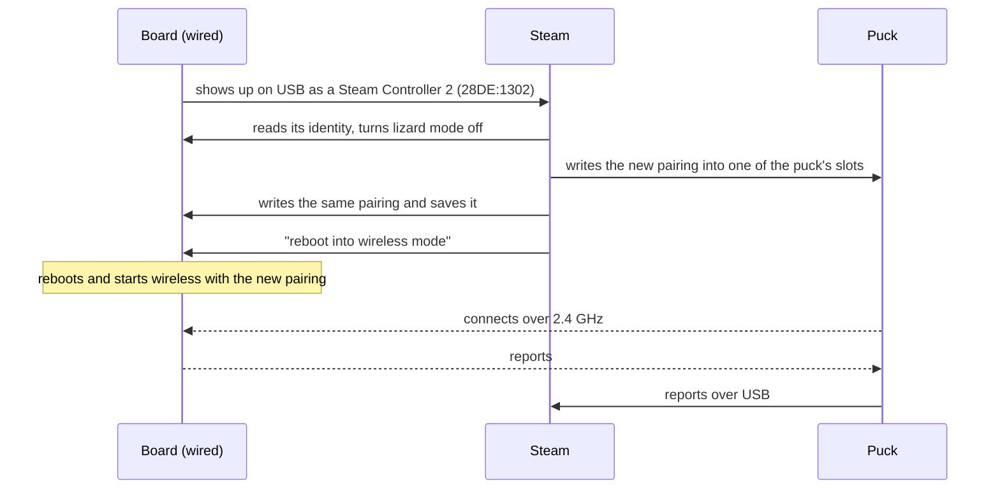

# Getting started

From a fresh PC to a board that Steam treats as a Steam Controller 2, step by step: for first-time
users, on Windows, Linux or macOS.

## What you need

| Thing | Notes |
| --- | --- |
| The SuperMini nRF52840 | a Pro Micro-sized nRF52840 board with the nice!nano pinout and the Adafruit nRF52 UF2 bootloader. Nothing needs to be wired to it. |
| Valve's puck | the small USB receiver and charging dock that comes with the Steam Controller 2. Steam talks to wireless controllers through it. Tested with its October 2026 firmware. |
| A Windows PC with Steam | the PC side was tested with Steam on Windows; Linux and macOS as the PC are not tested |
| A USB-C data cable | not a charge-only cable |
| To build: nRF Connect SDK v3.4.0 and git | on Windows, Linux or macOS (instead of git, GitHub's **Code**, **Download ZIP** works too). Or take a `.uf2` from a [release](https://github.com/ded811/OpenSC2-Controller/releases), if one is attached. |
| A short wire or tweezers | to short RST to GND for the bootloader, and to hold P0.31 against GND for the shell |

The SuperMini has three analog-capable pins (P0.02, P0.29, P0.31), and the default firmware uses
P0.31 for the pairing button: one analog stick. For two sticks and analog triggers, use a board
with six or more analog pins (for example the Seeed XIAO nRF52840, see [porting.md](porting.md);
untested) or an external ADC.

## Get the code

Windows (PowerShell):

```powershell
git clone https://github.com/ded811/OpenSC2-Controller C:\src\OpenSC2-Controller
cd C:\src\OpenSC2-Controller
```

Linux and macOS:

```sh
git clone https://github.com/ded811/OpenSC2-Controller ~/src/OpenSC2-Controller
cd ~/src/OpenSC2-Controller
```

Any folder works; a short one keeps Windows' path limit away (see [Build](#build)). Without git,
download the code from GitHub (**Code**, **Download ZIP**) and unpack it.

**Only flashing?** If a [release](https://github.com/ded811/OpenSC2-Controller/releases) has a
`.uf2` attached, you can download it instead of building, and check its SHA-256 against
`SHA256SUMS.txt`:

| OS | Command |
| --- | --- |
| Windows | `Get-FileHash -Algorithm SHA256 opensc2-supermini-nrf52840-v0.2.0.uf2` |
| Linux | `sha256sum opensc2-supermini-nrf52840-v0.2.0.uf2` |
| macOS | `shasum -a 256 opensc2-supermini-nrf52840-v0.2.0.uf2` |

Then go on with [Flash](#flash).

## Install the nRF Connect SDK

OpenSC2 needs the nRF Connect SDK, not plain Zephyr: the puck's radio link uses Nordic's Enhanced
ShockBurst, which comes with the SDK.

Install nRF Connect SDK v3.4.0 with nRF Connect for VS Code (Install SDK, then v3.4.0), or on the
command line with [nRF Util](https://www.nordicsemi.com/Products/Development-tools/nRF-Util)
(`nrfutil`, from Nordic's downloads for Windows, Linux and macOS):

```sh
nrfutil install sdk-manager
nrfutil sdk-manager install v3.4.0
```

The SDK lands in these folders by default; `build.ps1` looks in `C:\ncs`, and `-NcsRoot <folder>`
names another one:

| OS | The SDK | Its toolchain |
| --- | --- | --- |
| Windows | `C:\ncs\v3.4.0` | `C:\ncs\toolchains` |
| Linux | `~/ncs/v3.4.0` | `~/ncs/toolchains` |
| macOS | `/opt/nordic/ncs/v3.4.0` | `/opt/nordic/ncs/toolchains` |

The project uses the SDK as it is installed: no patches, nothing to change in it.

## Build

The firmware is in `app/`. Its board target is `promicro_nrf52840/nrf52840/uf2`.

### Windows

In PowerShell, in the repository folder:

```powershell
powershell -NoProfile -ExecutionPolicy Bypass -File build.ps1 -Project app -OutDir C:\b\osc2
```

This gives `C:\b\osc2\app\zephyr\zephyr.uf2` (the script ends with `UF2 ready:` and the path).
`C:\b\osc2` is any short folder: Windows' 260-character path limit breaks deep build folders.
`build.ps1` loads the SDK's toolchain by itself, so a plain PowerShell window is enough. Add
`-Pristine` to start the build folder over. Without `-OutDir` the build goes to
`build\app\app\zephyr\zephyr.uf2` inside the repository.

### Linux and macOS

Building on Linux and macOS follows the nRF Connect SDK's own instructions; it has not been tried
for this project yet. Run these from the repository folder. The first command opens a shell with
the SDK's tools; type the other two in that shell:

```sh
nrfutil sdk-manager toolchain launch --ncs-version v3.4.0 --shell   # opens the SDK's shell; go on in it
export ZEPHYR_BASE=~/ncs/v3.4.0/zephyr      # macOS: /opt/nordic/ncs/v3.4.0/zephyr
west build -b promicro_nrf52840/nrf52840/uf2 -d build/app app
```

This gives `build/app/app/zephyr/zephyr.uf2`. Add `-p always` to start the build folder over.

### nRF Connect for VS Code

Open the repository's `app` folder as an application, add a build configuration with the board
target `promicro_nrf52840/nrf52840/uf2`, and build. The image is `zephyr/zephyr.uf2` in the build
folder's `app` subfolder. This way has not been tried for this project yet.

## Flash

Short RST to GND twice quickly: a USB drive appears. Copy `zephyr.uf2` onto it; the board restarts
with the new firmware.

- The drive's `INFO_UF2.TXT` names the bootloader and its version. The build is for the Adafruit
  nRF52 UF2 bootloader with the S140 v6 layout of the board target: the application starts at
  `0x26000`, and the settings (the pairing, the identity) are in the storage partition at
  `0xEC000`-`0xF4000`, which a `.uf2` never writes. So a new build keeps the board's pairing.
- If no drive appears, the two shorts were too slow or too far apart: try again, a little faster.
  More in [troubleshooting](troubleshooting.md#the-uf2-drive-does-not-appear).

## Add it in Steam

1. Plug the puck into the PC and start Steam. Switch a real Steam Controller 2 off and keep it
   unplugged while you add the board.
2. In Steam, start adding a controller. Steam asks you to connect it with a USB-C cable.
3. Plug the board in with a USB-C data cable (not a charge-only cable). It comes up wired: the LED
   turns on once the PC has set the board up.
4. Steam pairs the board with the puck over the cable and reboots it into wireless mode: the LED
   goes dark, blinks slowly while the board looks for the puck, then stays on. The board is now
   connected through the puck.
5. From then on the board connects through the puck by itself whenever it starts wireless. Plugged
   into a PC again it comes up wired; hold the pairing button (on a bare board: P0.31 against GND)
   while plugging in to keep it wireless.

If Steam later forgets the controller, add it again the same way.

What happens on the cable:



The LED of the firmware in `app/` (the full table is in [app/README.md](../app/README.md#led)):

| LED | Means |
| --- | --- |
| on | wired, and the PC has set the board up; or wireless, connected through the puck |
| on, with a short dark blink every second | wired, but no PC has set the board up (a charger, a power bank); or wireless switched off on USB power (the PC went to sleep, Steam turned the controller off, STEAM held 7 s): STEAM brings it back wired, `opensc2 start` in the shell wireless |
| a slow blink, about 1 s on and 1 s off | wireless, looking for the puck (also when it is not paired yet) |
| two quick flashes, repeating | pairing over the air |
| off | the first second or so after power-up, a reboot, a shutdown |

These are the real controller's patterns, shown on the SuperMini's one-colour LED. The hardware
test suite checks which mode the firmware picks; the patterns have not been compared with a real
controller's.

The steps say "the board" for `app/`; the samples and the template have their own LED behaviour,
described in their READMEs.

## Reach the shell

The board has a USB serial console with a shell only in wireless mode. On a bare board, hold P0.31
against GND with a wire while plugging it in: it starts wireless and the console appears. Right
after Steam's pairing the board is wireless too.

It is the USB serial port with ID `2FE3:0004` and the product string "OpenSC2 console". On Windows
it is a new COM port under Ports (COM & LPT) in Device Manager. Open it with any serial terminal
(for example PuTTY, Tera Term or the nRF Connect Serial Terminal); the baud rate does not matter.
On Linux it is usually `/dev/ttyACM0`, on macOS `/dev/cu.usbmodem…` (Linux and macOS untested).

| Command | Does |
| --- | --- |
| `opensc2 status` | the mode and why, the link, the identity, the last wired session |
| `opensc2 bonds` | the two pairing slots |
| `opensc2 usb log` | what happened in the last wired sessions, request by request |
| `opensc2 id` | the identity Steam sees: serials, revision, build time |
| `opensc2 id set unit OSC2MYBOARD01` | give the board a serial of your choice (13 characters, 0-9 and A-Z) |
| `opensc2 reboot wired` | come back wired once |
| `uf2` | reboot into the UF2 bootloader (the drive appears), for the next `.uf2` |

Keep the OSC prefix: the hardware test suite only talks to boards whose serial starts with OSC.
The shell numbers the two pairing slots 1 and 2; the API numbers them 0 and 1. Every command:
[api.md](api.md#shell-commands).

> [!WARNING]
> `opensc2 bonds` shows your puck's serial, and `opensc2 status` and `opensc2 id` show the board's
> serials: mask them before you post them. `opensc2 usb log` and the test suite's reports are
> masked and safe to share.

## Wire buttons

Buttons go between their pin and GND; the internal pull-ups hold them released. A thumbstick
module's two potentiometers go between VCC and GND, with the wipers on P0.02 (X) and P0.29 (Y).
Anything you leave out reads neutral. The silkscreen labels are short: "006" is P0.06, "111" is
P1.11. The pins: [app/README.md](../app/README.md#pins).

## What next

| To | Read |
| --- | --- |
| start your own project | [template/](../template) and [integration.md](integration.md) |
| add a trackpad, an IMU, a motor or an RGB LED | [samples/README.md](../samples/README.md) |
| see everything the firmware does | [app/README.md](../app/README.md) |
| connect it over Bluetooth LE instead of the puck | [app/README.md, Bluetooth LE](../app/README.md#bluetooth-le) |
| use the library's API | [api.md](api.md) |
| check a board from the PC | [testing.md](testing.md) |
| fix something | [troubleshooting.md](troubleshooting.md) |

Back to the [documentation map](README.md).
