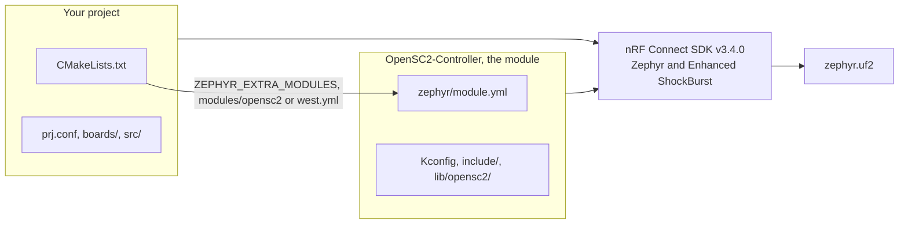

# Use OpenSC2 in your own project

How to build your own firmware on the OpenSC2 library, from a first try to a project of your own in
git. For firmware developers; some Zephyr helps, but the template is small enough to learn on. It
assumes nRF Connect SDK v3.4.0 is installed ([getting started](getting-started.md#install-the-nrf-connect-sdk)).

OpenSC2 is a Zephyr module for nRF Connect SDK v3.4.0. Your project brings the hardware: it reads
buttons, sticks, trackpads and sensors, hands their values to the library, and drives whatever
outputs it has. The library brings the protocols: the wired USB device that Steam pairs with
Valve's puck over the cable, the radio link through the puck, and the commands Steam sends. The
library has no pins.

- [Where to start](#where-to-start)
- [Bring in the library](#bring-in-the-library): [a plain folder](#way-1-a-plain-folder),
  [a git submodule](#way-2-a-git-submodule), [a west workspace](#way-3-a-west-workspace)
- [What every project needs](#what-every-project-needs)
- [Kconfig](#kconfig), [Devicetree](#devicetree), [Code](#code)
- [Build problems](#build-problems)
- [Next steps](#next-steps)

## Where to start

| Start from | Choose it when | You change |
| --- | --- | --- |
| [`template/`](../template/README.md) (recommended) | you write firmware of your own | anything: it is small and made to be copied out |
| [`app/`](../app/README.md) | you build a controller on the SuperMini with the parts `app/` supports; the hardware results come from its v0.2.0 release image ([What works](../README.md#what-works)) | usually only its overlay (pins and parts) |
| [`samples/`](../samples/README.md) | you want to see one part on its own: buttons and a stick, a touchpad, an IMU, rumble, an RGB LED, the haptics synthesiser | copy that part into your project |

The template is the OpenSC2 library, five buttons, a pairing button and a status LED on the
SuperMini nRF52840 (a Pro Micro-sized nRF52840 board with the nice!nano pinout and the Adafruit
nRF52 UF2 bootloader). It builds without warnings; it has not run on hardware
([template/README.md](../template/README.md)). This page uses it in its examples, with these
folders: `C:\src\OpenSC2-Controller` (your clone of this repository), `C:\src\my-controller`
(your project) and `C:\b\mine` (a short build folder), or `~/src/...` on Linux and macOS.

## Bring in the library

The library is the whole OpenSC2-Controller repository seen as a Zephyr module: its
`zephyr/module.yml` names the module `opensc2`. Zephyr's build finds modules in the west workspace
it runs in and in the folders listed in `ZEPHYR_EXTRA_MODULES`. The template's `CMakeLists.txt`
adds two places of its own before `find_package(Zephyr)`: a `modules/opensc2` folder inside the
project, and the repository around it while it is still `template/` in OpenSC2-Controller.



| Way | Where the library is | Good for |
| --- | --- | --- |
| [Way 1: a plain folder](#way-1-a-plain-folder) | a clone anywhere, named in `ZEPHYR_EXTRA_MODULES` | trying it; one PC |
| [Way 2: a git submodule](#way-2-a-git-submodule) | `modules/opensc2` inside your project's git repository, pinned to a release | a project you share: one clone gets everything |
| [Way 3: a west workspace](#way-3-a-west-workspace) | fetched by `west update`, next to a copy of the SDK, both pinned in your `west.yml` | teams, CI, and projects that already use west |

A module found twice (for example by west and by `ZEPHYR_EXTRA_MODULES`) is harmless: Zephyr keys
modules by name.

### Way 1: a plain folder

Clone the repository anywhere and give its top folder (the one with `zephyr/module.yml`) to the
build in `ZEPHYR_EXTRA_MODULES`, written with forward slashes. The build reads the variable from
the environment, from a `-D` argument, and from your `CMakeLists.txt`, and merges them. The builds
checked for this guide used the environment variable; the `-D` form reaches the same variable.

Windows, with `build.ps1` (PowerShell):

```powershell
git clone https://github.com/ded811/OpenSC2-Controller C:\src\OpenSC2-Controller
Copy-Item -Recurse C:\src\OpenSC2-Controller\template C:\src\my-controller
$env:ZEPHYR_EXTRA_MODULES = 'C:/src/OpenSC2-Controller'
powershell -NoProfile -ExecutionPolicy Bypass -File C:\src\OpenSC2-Controller\build.ps1 -Project C:\src\my-controller -OutDir C:\b\mine
# result: C:\b\mine\my-controller\zephyr\zephyr.uf2
```

`build.ps1 -Project` takes any folder with a `CMakeLists.txt`, inside or outside the repository;
the `.uf2` lands in `<OutDir>\<name of the project folder>\zephyr\zephyr.uf2`. Keep `-OutDir`
short: Windows' 260-character path limit breaks deep build folders. `build.ps1` looks for the SDK
in `C:\ncs`; add `-NcsRoot <folder>` for another one.

`$env:ZEPHYR_EXTRA_MODULES` lasts for this PowerShell window. To keep it for new windows (and for
nRF Connect for VS Code, once restarted):

```powershell
[Environment]::SetEnvironmentVariable('ZEPHYR_EXTRA_MODULES', 'C:/src/OpenSC2-Controller', 'User')
```

Every Zephyr build of yours then sees the module; it does nothing in a project without
`CONFIG_OPENSC2=y`.

Windows, with `west` directly: load the SDK's toolchain into PowerShell with the repository's
`ncs_env.ps1`, then give the folder as a CMake argument after `--`. Windows does not run scripts
by default, so the first line allows them for this PowerShell window only (no administrator
needed):

```powershell
Set-ExecutionPolicy -Scope Process -ExecutionPolicy Bypass
. C:\src\OpenSC2-Controller\ncs_env.ps1
west build -b promicro_nrf52840/nrf52840/uf2 -d C:\b\mine C:\src\my-controller -- -DZEPHYR_EXTRA_MODULES=C:/src/OpenSC2-Controller
# result: C:\b\mine\my-controller\zephyr\zephyr.uf2
```

Plain `west build` does not check for `partitions.yml` the way `build.ps1` does: after the first
build, make sure the build folder has none ([Build problems](#build-problems)).

Linux and macOS:

```sh
git clone https://github.com/ded811/OpenSC2-Controller ~/src/OpenSC2-Controller
cp -r ~/src/OpenSC2-Controller/template ~/src/my-controller
nrfutil sdk-manager toolchain launch --ncs-version v3.4.0 --shell   # opens the SDK's shell; go on in it
export ZEPHYR_BASE=~/ncs/v3.4.0/zephyr            # macOS: /opt/nordic/ncs/v3.4.0/zephyr
export ZEPHYR_EXTRA_MODULES=~/src/OpenSC2-Controller
west build -b promicro_nrf52840/nrf52840/uf2 -d ~/src/my-controller/build ~/src/my-controller
# result: ~/src/my-controller/build/my-controller/zephyr/zephyr.uf2
```

Building on Linux and macOS follows the nRF Connect SDK's own instructions; it has not been tried
for this project yet.

nRF Connect for VS Code: open your project folder as an application, then **Add Build
Configuration** with nRF Connect SDK v3.4.0 and its toolchain, the board target
`promicro_nrf52840/nrf52840/uf2`, and in **Extra CMake arguments**:

```text
-- -DZEPHYR_EXTRA_MODULES=C:/src/OpenSC2-Controller
```

Then build the configuration. (Field names as in the nRF Connect SDK v3.4.0 documentation; not
tried with this project yet.)

### Way 2: a git submodule

Keep the library inside your project's git repository, pinned to a release tag. The template looks
for `modules/opensc2` first, so the build needs no variable. Start in your copy of the template
(the `git clone` and `Copy-Item` lines of [Way 1](#way-1-a-plain-folder)). In PowerShell (on Linux
and macOS the same in `~/src/my-controller`):

```powershell
cd C:\src\my-controller
git init     # if it is not a git repository yet
git submodule add https://github.com/ded811/OpenSC2-Controller modules/opensc2
git -C modules/opensc2 checkout v0.2.0
git add -A   # your project's files and the submodule
git commit -m "My controller, with OpenSC2 v0.2.0 as a submodule"
```

`v0.2.0` is the first release; the
[releases](https://github.com/ded811/OpenSC2-Controller/releases) page lists the newest. Unset
`ZEPHYR_EXTRA_MODULES` if you set it for Way 1, so that only the submodule is in play. Then build:

```powershell
powershell -NoProfile -ExecutionPolicy Bypass -File C:\src\my-controller\modules\opensc2\build.ps1 -Project C:\src\my-controller -OutDir C:\b\mine
# result: C:\b\mine\my-controller\zephyr\zephyr.uf2
```

```sh
west build -b promicro_nrf52840/nrf52840/uf2 -d ~/src/my-controller/build ~/src/my-controller
# result: ~/src/my-controller/build/my-controller/zephyr/zephyr.uf2
```

- Someone who clones your project gets the library too with
  `git clone --recurse-submodules <your repository>` (or `git submodule update --init` after a
  plain clone).
- To move to a newer release: `git -C modules/opensc2 fetch --tags`, then
  `git -C modules/opensc2 checkout <tag>`, then commit the change.
- The build uses only five parts of the submodule: `zephyr/`, `CMakeLists.txt`, `Kconfig`,
  `include/` and `lib/`. A plain copy of just these at `modules/opensc2` works the same way, if you
  would rather not use a submodule (build it with `build.ps1` from a clone, or with west).

### Way 3: a west workspace

West can fetch nRF Connect SDK v3.4.0 and OpenSC2 together, both pinned in your project's
`west.yml`; your project is then the manifest repository of its own workspace (the "workspace
application" of the nRF Connect SDK's documentation). The template has a `west.yml` to start from:

```yaml
manifest:
  remotes:
    - name: ncs
      url-base: https://github.com/nrfconnect
    - name: ded811
      url-base: https://github.com/ded811
  projects:
    - name: nrf
      repo-path: sdk-nrf
      remote: ncs
      revision: v3.4.0
      import: true
    - name: opensc2
      repo-path: OpenSC2-Controller
      remote: ded811
      revision: v0.2.0
      path: modules/lib/opensc2
  self:
    path: my-controller
```

- `nrf` is the nRF Connect SDK at v3.4.0; `import: true` brings in Zephyr and the SDK's other
  repositories.
- `opensc2` is this repository at tag `v0.2.0`, fetched into `modules/lib/opensc2`. West hands it
  to the build, so the template's own checks find nothing and change nothing.
- `self.path` is the name of your project's folder in the workspace.

Set up the workspace in an empty folder that will hold it:

```sh
mkdir my-workspace
cd my-workspace
git clone <your project's repository> my-controller
west init -l my-controller
west update -o=--depth=1 -n
west build -b promicro_nrf52840/nrf52840/uf2 -d build/my-controller my-controller
# result: build/my-controller/my-controller/zephyr/zephyr.uf2
```

Run these with the toolchain of an installed nRF Connect SDK v3.4.0 and without `ZEPHYR_BASE`, so
that west uses the workspace's own copy of the SDK: in the shell that
`nrfutil sdk-manager toolchain launch --ncs-version v3.4.0 --shell` opens, or on Windows in a
PowerShell window prepared like this (the first line allows scripts in this window only):

```powershell
Set-ExecutionPolicy -Scope Process -ExecutionPolicy Bypass
. C:\src\OpenSC2-Controller\ncs_env.ps1
Remove-Item env:ZEPHYR_BASE
```

The workspace holds its own copy of the SDK's repositories, apart from the one you installed;
`west update` fetches them.

For a workspace that already has a manifest, add the remote and the project to it, then run
`west update opensc2`:

```yaml
manifest:
  remotes:
    # ... your remotes, then:
    - name: ded811
      url-base: https://github.com/ded811
  projects:
    # ... your projects, then:
    - name: opensc2
      repo-path: OpenSC2-Controller
      remote: ded811
      revision: v0.2.0
      path: modules/lib/opensc2
```

> [!NOTE]
> Not built this way yet. The template's `west.yml` is checked with west's own manifest parser,
> and its layout is the one the nRF Connect SDK v3.4.0 documents for workspace applications, but no
> workspace has been set up and built from it; the release checklist asks for one try.

## What every project needs

Six files. The template has all of them; the parts that belong to the SuperMini are marked.

| File | What OpenSC2 needs in it | SuperMini only |
| --- | --- | --- |
| `CMakeLists.txt` | the module search before `find_package(Zephyr)`: Way 2 and a build inside the repository need it; Way 1 and Way 3 do not, but it does no harm there | |
| `prj.conf` | the library's Kconfig lines, wired mode, storage; the log and the shell if you want them ([Kconfig](#kconfig)) | |
| `sysbuild.conf` | `SB_CONFIG_PARTITION_MANAGER=n`, for a board with a fixed partition table | needed on UF2 boards such as the SuperMini |
| `boards/<board>.overlay` | the HID node and the retained RAM region for wired mode, and your inputs ([Devicetree](#devicetree)) | the region's address (`0x2002C000`, clear of the UF2 bootloader's RAM) and `sram0`'s size; `vcc-enable-gpios` (P0.13 on nice!nano-style boards) where `app/` powers potentiometers |
| `boards/<board>.conf` | Kconfig lines for this board only | the RC oscillator lines: the SuperMini has no 32.768 kHz crystal |
| `src/main.c` | `opensc2_init()`, the setters, the callbacks ([Code](#code)) | |

`<board>` is the board target with `/` turned into `_`: `promicro_nrf52840/nrf52840/uf2` gives
`boards/promicro_nrf52840_nrf52840_uf2.overlay` and `.conf`. Zephyr reads the `.conf` after
`prj.conf`, and the `.overlay` on top of the board's own devicetree. For another board, see
[porting.md](porting.md).

## Kconfig

Required in every project:

| Line | Why |
| --- | --- |
| `CONFIG_OPENSC2=y` | the library. It selects the nRF Connect SDK's Enhanced ShockBurst (`CONFIG_ESB`), the puck's radio link |
| `CONFIG_ESB_MAX_PAYLOAD_LENGTH=128` | the puck sends packets of up to 128 bytes (128 or more, checked at build time) |
| `CONFIG_ESB_TX_FIFO_SIZE=2` | recommended: the real controller keeps two replies queued |
| `CONFIG_FLASH=y`, `CONFIG_FLASH_MAP=y`, `CONFIG_NVS=y`, `CONFIG_SETTINGS=y`, `CONFIG_SETTINGS_NVS=y` | the bonds, the identity and the mode policy survive a reboot, in the board's `storage_partition`. Without them every pairing is lost at the next reboot, and Steam's pairing over the cable is followed by one (with wired mode on, the build warns) |

Wired mode (it turns on by itself when the devicetree has the HID node, and uses Zephyr's USB
device stack, which the SuperMini's board files enable):

| Line | Why |
| --- | --- |
| `CONFIG_CDC_ACM_SERIAL_INITIALIZE_AT_BOOT=n` | the library runs the USB device itself, so the board's serial port must not start at boot (checked at build time); in wireless mode the library shows the console instead |
| `CONFIG_USBD_HID_IN_BUF_COUNT=8` | eight input reports may wait for the PC, as on the real controller |
| `CONFIG_USBD_THREAD_STACK_SIZE=2048` | vendor commands that write flash (Steam's bond) run in the USB stack's thread (checked at build time) |
| `CONFIG_SYSTEM_WORKQUEUE_STACK_SIZE=2048` | the library's other wired-mode work (USB state changes, the session log, reboots) runs in the system work queue, and so does the flash write after `0xF2` reads a new crash record, on every link (keep the line in a wireless-only project too) |
| `CONFIG_LOG_PROCESS_THREAD_STACK_SIZE=1536` | with `CONFIG_LOG`: while wired the log thread also writes the USB session log (checked at build time; or `CONFIG_OPENSC2_USB_LOG_ZEPHYR=n`) |

The board (here the SuperMini):

| Line | Where | Why |
| --- | --- | --- |
| `CONFIG_CLOCK_CONTROL_NRF_K32SRC_RC=y`, `CONFIG_CLOCK_CONTROL_NRF_K32SRC_RC_CALIBRATION=y` | `boards/<board>.conf` | no 32.768 kHz crystal: the internal RC oscillator, calibrated. A board with the crystal leaves them out |
| `SB_CONFIG_PARTITION_MANAGER=n` | `sysbuild.conf` | the Partition Manager would ignore the board's fixed UF2 layout (the application at `0x26000`, the settings at `0xEC000`) |

Optional, as in the template: buttons as `gpio-keys` (`CONFIG_GPIO=y`, `CONFIG_INPUT=y`); the log
and the shell on the console in wireless mode (`CONFIG_LOG=y`, `CONFIG_SHELL=y`,
`CONFIG_LOG_BACKEND_UART=n`, `CONFIG_SHELL_PROMPT_UART="opensc2:~$ "`); a priority
below the library's threads for a `main()` that keeps running (`CONFIG_MAIN_THREAD_PRIORITY=7`,
`CONFIG_MAIN_STACK_SIZE=2048`); the revision string Steam reads (`CONFIG_OPENSC2_GIT_REVISION`, 1 to
12 characters, `osc2-0.2.0` by default). Every option: [api.md](api.md#kconfig-options).

## Devicetree

The library reads two chosen nodes. Everything else in the overlay belongs to your application.

| Node | What it is | From |
| --- | --- | --- |
| `opensc2,usb-hid`: a `zephyr,hid-device` node with 64-byte input and output reports, polled every 1000 µs | the one HID interface of the wired Steam Controller 2; wired mode turns on when it is there (the report sizes are checked at build time) | your overlay |
| `opensc2,retained-ram`: a `zephyr,memory-region` of 16 KB, with `sram0` shrunk by its size | RAM that a soft reset keeps, for the warm-restart mark (Steam's "reboot into wireless mode"), the USB session log and a crash record waiting for the next boot. Recommended: without it the build warns | your overlay |
| `storage_partition` | where the settings (the bonds) live | the board |
| `zephyr_udc0` and a `zephyr,cdc-acm-uart` node | the USB device controller, and the serial console in wireless mode | the board (the SuperMini's files have both) |

The wired-mode part of the template's overlay:

```dts
/ {
	chosen {
		opensc2,usb-hid = &opensc2_hid;
		opensc2,retained-ram = &opensc2_retained;
	};

	opensc2_hid: opensc2_hid {
		compatible = "zephyr,hid-device";
		in-report-size = <64>;
		in-polling-period-us = <1000>;
		out-report-size = <64>;
		out-polling-period-us = <1000>;
	};

	opensc2_retained: memory@2002c000 {
		compatible = "zephyr,memory-region", "mmio-sram";
		reg = <0x2002c000 DT_SIZE_K(16)>;
		zephyr,memory-region = "OPENSC2_RETAINED";
	};
};

/* The application's RAM ends below the retained area. */
&sram0 {
	reg = <0x20000000 DT_SIZE_K(176)>;
};
```

The region must be clear of the RAM your bootloader uses at a reset; the address above is the
SuperMini's choice. [porting.md](porting.md#where-the-retained-region-may-go) has the UF2
bootloader's ranges.

Inputs are your application's business. The template and `app/` use one convention, which only
their own code reads: a `gpio-keys` node labelled `opensc2_buttons` whose keys have a
`zephyr,code` from `OPENSC2_KEY_*`, and the pairing button labelled `opensc2_pair` with
`OPENSC2_KEY_PAIR`. `#include <dt-bindings/opensc2/inputs.h>` in the overlay gives the codes (the
module adds its `include/` folder to the devicetree's include path). The nRF52840 has only eight
GPIOTE channels, and `gpio-keys` fails on a ninth button (`-ENOMEM`) unless the GPIO ports detect
edges by sensing, as the template and `app/` set up:

```dts
&gpio0 { sense-edge-mask = <0xffffffff>; };
&gpio1 { sense-edge-mask = <0xffff>; };
```

> [!WARNING]
> Properties in `zephyr,user` are not checked against any binding. A misspelled name (for
> example `invert-left-stik-x`) builds without a word and silently does nothing. `app/` reads its
> sticks, outputs and options from `zephyr,user`: compare each name with the code that reads it.

## Code

The template's `main()`, shortened:

```c
#include <opensc2/opensc2.h>

static const struct opensc2_callbacks callbacks = {
	.link_changed = on_link,   /* every callback is optional */
};

int main(void)
{
	struct opensc2_config config = {
		.callbacks = &callbacks,
		.bond_slot = OPENSC2_SLOT_STORED,   /* the pairing slot chosen last */
		.start = true,                      /* wireless: start the radio at once */
	};
	int err;

	if (pair_pin_held()) {
		config.boot_mode = OPENSC2_BOOT_WIRELESS;   /* held at power-up: wireless this boot */
	}
	err = opensc2_init(&config);
	if (err) {
		LOG_ERR("opensc2_init failed (%d)", err);
		return err;
	}
	/* From now on, from any thread, whenever an input changes: */
	opensc2_set_buttons(OPENSC2_BTN_A, OPENSC2_BTN_A);   /* A pressed */
	opensc2_set_stick(OPENSC2_LEFT, x, y);               /* -32767..32767, up positive */
	...
}
```

| Part | Rule |
| --- | --- |
| `opensc2_init(&config)` | once, from `main()`. It loads the bonds and the identity, decides this boot's mode, then starts the USB device (wired) or the radio (wireless; with the system state machine, the default, when its power-on rules say so: at once on USB power, after its 1 s wait on a battery). It returns 0 or a negative errno (`-EINVAL` for an invalid identity); after an error the serial console still starts, so the log can be read. |
| The setters | `opensc2_set_buttons()`, `opensc2_set_stick()`, `opensc2_set_trigger()`, `opensc2_set_trackpad()`, `opensc2_set_imu()`, `opensc2_set_battery()`: thread safe and cheap; call them whenever a value changes. Anything never set reads neutral. |
| The callbacks | run in the library's threads: the radio thread through the puck; the USB report thread or the USB stack's thread while wired; over Bluetooth the Bluetooth report thread (`sample`, lizard mode's haptic events), the Bluetooth host's receive thread (output reports, vendor commands) and the Bluetooth thread (`link_changed`); with the dock link the dock thread; power requests, USB state changes, the LED status and cues in the system work queue. One callback can come from several of these threads: guard what they share. Return quickly, well under a millisecond, and hand slow work to a thread or work queue of your own ([api.md](api.md#threads-and-timing)). |
| The mode | decided once per boot in `opensc2_init()`, as on the real controller: wired at a boot with USB power, wireless after Steam's reboot into wireless mode or without USB power. `config.boot_mode = OPENSC2_BOOT_WIRELESS` for a pairing button held at power-up ([api.md](api.md#modes)). |
| The pairing button | the template's rules: held while plugging in, this boot is wireless; pressed and released while wired, `opensc2_reboot_later(OPENSC2_REBOOT_WIRELESS, "pair button", 0)`; pressed while wireless, `opensc2_pair_start(0)` (it answers an open pairing window; untested with Steam). |
| Reboots | `opensc2_reboot()` sleeps 10 ms and must not run in the USB stack's thread. From a callback or an input handler, use `opensc2_reboot_later()`, which returns at once. |
| Power requests | without a `power_request` callback the library carries out the reboots Steam asks for itself and ignores Steam's request to enter a bootloader. With one, you decide ([api.md](api.md#power-requests)). The system state machine (on by default; built, not yet tested on hardware) also runs the real controller's power rules: STEAM held 7 s and the turn-off command switch wireless off on USB power; on a battery they, the idle timeout and low battery shut the board down. A board built without `CONFIG_OPENSC2_BATTERY` counts as on USB power and never switches itself off (a shutdown ends in a reboot); a battery build gets `OPENSC2_POWER_OFF` ([api.md](api.md#power-and-the-system-state-machine)). |
| The status LED and cues | optional (built, not yet tested on hardware): the `led_status` callback (or `opensc2_led_status()`) gives the mode the real controller would show, and `<opensc2/led.h>` plays its patterns for you; the `cue` callback names each chime to play, which the haptics synthesiser plays itself when it is built in ([api.md](api.md#status-led), [Cues](api.md#cues)). |
| Priorities | the radio thread runs at priority 5 (`CONFIG_OPENSC2_THREAD_PRIORITY`): keep long-running application threads below it, at a higher number (the template's `main()` runs at 7). |
| Haptics | the `rumble` and `haptic` callbacks hand over what Steam plays; to have it played as the real controller plays it, turn on the library's haptics synthesiser (`CONFIG_OPENSC2_HAPTICS_SYNTH`) and give it outputs, its built-in ones or your own ([api.md](api.md#the-haptics-synthesiser), [samples/haptics](../samples/haptics/README.md); built, not yet tested on hardware). |

Every function, field and callback: [api.md](api.md). The wired device in detail:
[api.md](api.md#wired-mode).

## Build problems

| You see | Cause | Fix |
| --- | --- | --- |
| `<folder>, given in ZEPHYR_EXTRA_MODULES, is not a valid zephyr module` | the folder is not the repository's top folder (the one with `zephyr/module.yml`) | correct the path; write it with forward slashes |
| `attempt to assign the value 'y' to the undefined symbol OPENSC2`, then `Aborting due to Kconfig warnings` | the build did not find the module | bring it in one of the [three ways](#bring-in-the-library) |
| `OpenSC2 needs the nRF Connect SDK v3.4.0 (its Enhanced ShockBurst, CONFIG_ESB)`, or Kconfig's `undefined symbol ESB_MAX_PAYLOAD_LENGTH` | a plain Zephyr without the nRF Connect SDK: it has no ESB | build with nRF Connect SDK v3.4.0 (`build.ps1` and `ncs_env.ps1` set `ZEPHYR_BASE` to it) |
| `Partition Manager output found (partitions.yml)` from `build.ps1`, or a `partitions.yml` in the build folder | `sysbuild.conf` is missing, or the build folder is older than it | add `sysbuild.conf`, then build from scratch (`-Pristine`, or `west build -p always`) |
| on Windows, "file not found" or path errors deep inside the build folder | Windows' 260-character path limit | a short build folder: `-OutDir C:\b\mine` |
| the warning `OpenSC2: wired mode (CONFIG_OPENSC2_USB) is on, but the bonds are not stored` | the storage lines are missing | add the five lines ([Kconfig](#kconfig)) |
| the warning `OpenSC2: no devicetree region is chosen as opensc2,retained-ram` | no retained RAM region | add the region and shrink `sram0` ([Devicetree](#devicetree)) |
| `multiple definition of 'k_sys_fatal_error_handler'` | your application (or another module) has a fatal-error handler of its own, and so does the library with its crash records | `CONFIG_OPENSC2_CRASH_RECORD=n` ([api.md](api.md#crash-records)) |
| a static assertion: `Set CONFIG_CDC_ACM_SERIAL_INITIALIZE_AT_BOOT=n`, `Set CONFIG_USBD_THREAD_STACK_SIZE=2048`, `Set CONFIG_LOG_PROCESS_THREAD_STACK_SIZE=1536` or `OpenSC2 needs CONFIG_ESB_MAX_PAYLOAD_LENGTH of 128 or more` | a line from the [Kconfig](#kconfig) tables is missing | add it |
| `OpenSC2: CONFIG_OPENSC2_GIT_REVISION "..." must be ...` (or the same for a serial or the USB product string) | a value breaks the identity's rules; the board would not start as a controller | correct the value as the message says |
| `The build time ... is at or before 0x6A18D057` | the PC's clock, or `CONFIG_OPENSC2_BUILD_TIME`, is that old: Steam would force an update the board cannot take | set the clock right, or a later `CONFIG_OPENSC2_BUILD_TIME` |
| `No toolchain index at C:\ncs\toolchains\toolchains.json` from `build.ps1` | nRF Connect SDK v3.4.0 is not installed, or is in another folder | install it, or pass `-NcsRoot <folder>` |

## Next steps

- Flash the board and add it in Steam: [getting started](getting-started.md#flash) and
  [Add it in Steam](getting-started.md#add-it-in-steam). Then check it on the serial console with
  `opensc2 status` ([reach the shell](getting-started.md#reach-the-shell)).
- Steam asks for a controller update:
  [troubleshooting](troubleshooting.md#steam-asks-to-update-the-controller).
- Another board: [porting.md](porting.md).
- The automated hardware test suite: [testing.md](testing.md). It was written for and run against
  `app/`; with `CONFIG_OPENSC2_TEST_HOOKS=y` it may work with your firmware too, but that has not
  been tried.

---

Back to the [documentation map](README.md).
